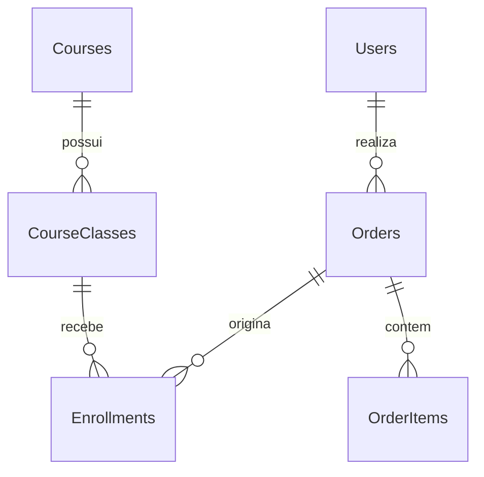

# PIM4API — API da plataforma de cursos

API central da plataforma MediShop, desenvolvida em ASP.NET Core/.NET 10 com Entity Framework Core e PostgreSQL. Atende o site Angular, o administrativo Windows/WPF e o futuro aplicativo Android.

**Atualizado em 11/10/2026.** O escopo atual é a venda e gestão de cursos presenciais. A tabela `Products` foi removida. Pagamento externo e publicação online ainda estão pendentes. O aplicativo Flutter Android do aluno tem uma primeira implementação em PIM4Mobile, em validação para distribuição.

## Índice

- [Projetos e documentação](#projetos-e-documentação)
- [Funcionalidades e modelo](#funcionalidades-e-modelo)
- [Tecnologias e requisitos](#tecnologias-e-requisitos)
- [Configuração](#configuração)
- [Executar com Docker](#executar-com-docker)
- [Executar a API fora do Docker](#executar-a-api-fora-do-docker)
- [Banco e migrations](#banco-e-migrations)
- [Autenticação e administrador](#autenticação-e-administrador)
- [Endpoints principais](#endpoints-principais)
- [Pagamento de teste e webhook local](#pagamento-de-teste-e-webhook-local)
- [Testes e CI](#testes-e-ci)
- [Backup e restauração](#backup-e-restauração)
- [Publicação](#publicação)
- [Problemas comuns e pendências](#problemas-comuns-e-pendências)

## Projetos e documentação

```text
D:\Projetos\
├── PIM4API\       # Este repositório
├── PIM4Front\     # Site Angular e E2E
├── PIM4Desktop\   # Administrativo Windows/WPF
└── PIM4Mobile\    # Aplicativo Flutter Android do aluno
```

O Compose usa `../PIM4Front` como contexto de build do site. Mantenha as pastas irmãs ou ajuste esse contexto.

| Documento | Finalidade |
| --- | --- |
| [FLUXO-DE-DESENVOLVIMENTO.md](FLUXO-DE-DESENVOLVIMENTO.md) | Histórico, decisões, etapas e contexto completo |
| [README do frontend](../PIM4Front/README.md) | Instalação, rotas, testes e publicação do site |
| [README do desktop](../PIM4Desktop/README.md) | Configuração e distribuição Windows |
| [docs/API.md](docs/API.md) | Documentação complementar de contratos |
| [docs/API_REAL_PRODUCAO.md](docs/API_REAL_PRODUCAO.md) | Planejamento de API/produção |
| [backend/openapi.yaml](backend/openapi.yaml) | Contrato alvo, que pode conter recursos planejados |

Este README descreve a configuração atual. O fluxo e os documentos de planejamento também contêm referências antigas a Products, caminhos em `E:\` e contratos ainda não implementados. Para confirmar endpoints disponíveis, consulte os controllers e o OpenAPI gerado pela aplicação.

## Funcionalidades e modelo

- Catálogo público com paginação, busca, filtros e opções de filtro.
- Administração de cursos, turmas, alunos, cupons, pedidos e auditoria.
- Cadastro, login JWT, refresh token, perfil e autorização por usuário/role.
- Criação de pedidos com chave de idempotência e reserva de vagas.
- Expiração de pedidos pendentes e liberação de reservas.
- Webhook interno assinado e criação de matrícula após pagamento confirmado.
- Consulta de matrículas e detalhes da turma pelo aluno.
- Código de EAD, aulas, progresso, avaliações e certificados existente; criação de EAD atualmente desabilitada no fluxo de oferta de cursos.



### Regras atuais

- `CourseClasses.CourseId` aponta para `Courses`. A turma não depende de Products.
- Novos pedidos usam `CourseId` e, para cursos presenciais, a turma selecionada.
- Para inscrição, curso ativo e turma `scheduled`, com vagas e início futuro.
- A disponibilidade usa o horário completo, não apenas o dia.
- Pedido `pending` não concede acesso. O aluno recebe matrícula após confirmação `paid`.
- Pedidos pendentes expiram, por padrão, após **30 minutos**; o serviço verifica a cada minuto.
- Eventos repetidos não devem duplicar matrículas ou consumir vagas novamente.
- Confirmação após o encerramento da reserva requer conciliação; não libera acesso automaticamente.
- Itens históricos preservam nome, tipo e preço. Equipamentos antigos podem existir no histórico com `CourseId` nulo; não são aceitos como novas compras.
- Arquivar um curso preserva seu histórico.

## Tecnologias e requisitos

| Tecnologia | Versão/configuração do repositório |
| --- | --- |
| ASP.NET Core / SDK .NET | 10.0 |
| Entity Framework Core Design/Tools | 10.0.11 |
| Npgsql EF Core | 10.0.3 |
| PostgreSQL | Imagem `postgres:17-alpine` |
| Autenticação | JWT Bearer e BCrypt |
| Testes | xUnit, EF SQLite e coverlet |
| Container API | Build SDK 10.0; runtime ASP.NET 10.0 |
| Container frontend | Node.js 24 e Nginx 1.29 |

Para rodar o ambiente completo: Docker com Compose e containers Linux. No Windows: Docker Desktop com WSL 2.

O SDK .NET 10 é necessário para rodar, testar ou gerar migrations fora dos containers. Os comandos deste README usam PowerShell e assumem a pasta raiz do PIM4API.

## Configuração

Copie o exemplo **somente se ainda não existir um `.env`**:

```powershell
cd D:\Projetos\PIM4API
if (-not (Test-Path -LiteralPath .env)) {
    Copy-Item -LiteralPath .env.example -Destination .env
}
```

Edite o arquivo e substitua os valores `CHANGE_THIS...` por configurações locais próprias. Não publique o `.env` nem compartilhe seus valores.

| Variável | Finalidade |
| --- | --- |
| `ASPNETCORE_ENVIRONMENT` | `Development` local; `Production` online |
| `API_PORT` / `FRONTEND_PORT` | Portas públicas dos serviços Docker |
| `POSTGRES_DB` / `POSTGRES_USER` / `POSTGRES_PASSWORD` | Criação/configuração do PostgreSQL no Compose |
| `POSTGRES_PORT` | Porta do banco exposta no host |
| `ConnectionStrings__DefaultConnection` | Conexão utilizada pela API; tem prioridade sobre `Postgres__*` |
| `Postgres__Host` / `Database` / `Username` / `Password` | Configuração alternativa, com o prefixo `Postgres__` em cada chave |
| `Postgres__Port` / `Postgres__SslMode` | Porta alternativa e modo SSL |
| `Jwt__Secret` | Chave JWT com pelo menos 32 bytes |
| `Jwt__Issuer` / `Jwt__Audience` | Emissor e público dos tokens |
| `Jwt__ExpirationHours` | Duração maior que zero e até 24 horas |
| `Cors__AllowedOrigins__0` | Primeira origem permitida; use índices seguintes para outras |
| `Payments__WebhookSecret` | Segredo HMAC do webhook interno |
| `Payments__PendingOrderExpirationMinutes` | Expiração de pedidos; padrão 30 |
| `Database__ApplyMigrationsOnStartup` | Habilita migrations na inicialização fora de Development |
| `Https__RedirectEnabled` | Redirecionamento HTTPS; padrão ligado em produção |

As chaves `Postgres__Database`, `Postgres__Username` e `Postgres__Password` devem ser informadas completas. `POSTGRES_DB` e `POSTGRES_PASSWORD` configuram o container do banco e não substituem, sozinhas, a conexão da API.

No Docker, o host do banco na conexão é `postgres`. Para API executada diretamente no Windows, utilize `localhost` e a porta pública do PostgreSQL. A senha da conexão precisa corresponder à senha do banco.

O `.env.example` não contém a chave do webhook. Para testes de pagamento, acrescente ao `.env` local uma chave aleatória própria:

```dotenv
Payments__WebhookSecret=SUBSTITUA_POR_UMA_CHAVE_LOCAL_ALEATORIA
```

Depois de alterar o `.env`, recrie a API: `docker compose up -d --no-deps api`. O `.env` é carregado pelo Compose; `dotnet run` não o lê automaticamente.

### Limites dos containers

| Serviço | CPU padrão | Memória padrão | Variáveis |
| --- | --- | --- | --- |
| PostgreSQL | 2 | 1024 MB | `POSTGRES_CPUS` / `POSTGRES_MEMORY_LIMIT` |
| API | 2 | 1024 MB | `API_CPUS` / `API_MEMORY_LIMIT` |
| Frontend | 0,5 | 256 MB | `FRONTEND_CPUS` / `FRONTEND_MEMORY_LIMIT` |

Esses limites valem para execução, não para build das imagens. O Compose persiste o banco no volume `postgres-data`.

## Executar com Docker

**Se o banco já contém dados antigos, faça backup antes de iniciar uma versão que aplique novas migrations.** A cadeia atual inclui a remoção de Products.

Com as configurações prontas:

```powershell
docker compose up -d --build
docker compose ps
```

| Serviço | Endereço padrão |
| --- | --- |
| Site | http://localhost:4200 |
| API | http://localhost:5278/api |
| Saúde da API | http://localhost:5278/health |
| OpenAPI em Development | http://localhost:5278/openapi/v1.json |
| PostgreSQL | localhost:5432 |

`/health` retorna 200 quando consegue conectar ao banco e 503 quando não consegue. Isso não valida todas as regras de negócio ou todos os objetos do schema.

Operações frequentes:

```powershell
docker compose logs --tail 100 api
docker compose logs --tail 100 frontend
docker compose logs --tail 100 postgres
docker compose up -d --build --no-deps api
docker compose up -d --build --no-deps frontend
docker compose stop
```

O último comando para os serviços sem apagar os dados. Não use `docker compose down -v` em um ambiente com dados que deseja preservar: ele remove os volumes.

## Executar a API fora do Docker

Inicie apenas o PostgreSQL:

```powershell
docker compose up -d postgres
docker compose stop api
```

Configure as variáveis no terminal. Os valores abaixo são exemplos; substitua as senhas/chaves e ajuste a porta do banco conforme seu `.env`:

```powershell
$env:ASPNETCORE_ENVIRONMENT = 'Development'
$env:ConnectionStrings__DefaultConnection = 'Host=localhost;Port=5432;Database=medishop;Username=medishop;Password=SUA_SENHA_LOCAL'
$env:Jwt__Secret = 'SUBSTITUA_POR_UMA_CHAVE_ALEATORIA_COM_PELO_MENOS_32_BYTES'
$env:Jwt__Issuer = 'MediShopAPI'
$env:Jwt__Audience = 'MediShopFrontend'
$env:Jwt__ExpirationHours = '1'
$env:Payments__WebhookSecret = 'MESMA_CHAVE_CONFIGURADA_NO_ENV_LOCAL'
dotnet restore backend/backend.csproj
dotnet run --project backend/backend.csproj --no-launch-profile --urls http://localhost:5278
```

Em Development, a aplicação aplica migrations ao iniciar. O frontend pode ser executado com `npm start` em sua própria pasta.

## Banco e migrations

As migrations ficam em [backend/Migrations](backend/Migrations). Não edite migrations já aplicadas para substituir uma nova alteração de schema.

- Development: migrations aplicadas automaticamente na inicialização.
- Production: aplicação automática apenas se `Database__ApplyMigrationsOnStartup=true`.
- O blueprint Render de demonstração habilita essa opção explicitamente.
- Produção com clientes exige backup e um processo controlado de atualização.

Para inspecionar/aplicar migrations manualmente, com conexão e JWT já configurados no terminal:

```powershell
dotnet tool install --global dotnet-ef --version 10.0.11
dotnet ef migrations list --project backend/backend.csproj
dotnet ef database update --project backend/backend.csproj
```

Se a ferramenta já estiver instalada, confirme a versão com `dotnet ef --version` em vez de reinstalá-la.

A migration `20261008160715_RemoveProducts` remove o legado. Ela não tem rollback automático para reconstruir os dados removidos: o retorno depende de backup e da versão anterior da aplicação.

## Autenticação e administrador

A API retorna access token JWT e refresh token no login. Requisições protegidas utilizam `Authorization: Bearer <token>`. Administração exige role `Admin`; o cadastro público cria role `Cliente`.

Há validação de senha, bloqueio após tentativas inválidas, rotação de refresh token e limitação de requisições. As consultas de pedidos e matrículas verificam vínculo com o usuário autenticado.

Para preparar acesso administrativo local, utilize uma conta administrativa já provisionada ou cadastre uma conta fictícia e atribua a role por acesso autorizado ao banco. Não há cadastro público para escolher a role Admin. Revise contas administrativas e seeds históricos antes de publicar; não adote credenciais de demonstração em produção.

Desktop e futuro Android devem acessar a API por HTTPS e JWT. Não distribua senha do PostgreSQL ou segredo de webhook aos clientes.

## Endpoints principais

As rotas abaixo refletem os controllers atuais. Não são uma reprodução de todas as operações.

| Método e rota | Acesso | Uso |
| --- | --- | --- |
| `GET /health` | Público | Conectividade com banco |
| `GET /openapi/v1.json` | Development | Contrato gerado |
| `POST /api/Auth/cadastrar` | Público | Cadastro Cliente |
| `POST /api/Auth/login` | Público | Login |
| `POST /api/Auth/refresh` | Refresh token válido | Renovação de sessão |
| `POST /api/Auth/logout` | Autenticado | Encerramento de sessão no servidor |
| `PUT /api/Auth/perfil` | Autenticado | Perfil |
| `GET /api/courses/catalog` | Público | Catálogo paginado |
| `GET /api/courses/catalog/options` | Público | Opções de filtros |
| `GET /api/courses/{id}` | Público | Detalhes do curso |
| `GET /api/courses` | Admin | Lista administrativa |
| `POST /api/courses` / `PUT /api/courses/{id}` | Admin | Criar/editar curso |
| `POST /api/courses/{id}/archive` / `restore` | Admin | Arquivar/restaurar |
| `GET /api/courses/{courseId}/classes` | Público | Turmas |
| `POST /api/courses/{courseId}/classes` | Admin | Criar turma |
| `PUT /api/courses/{courseId}/classes/{classId}` | Admin | Editar turma |
| `GET /api/courses/{courseId}/classes/{classId}/students` | Admin | Alunos da turma |
| `POST /api/Orders` | Autenticado | Criar pedido |
| `GET /api/Orders/my` | Autenticado | Pedidos próprios |
| `GET /api/Orders/{id}` | Proprietário | Pedido |
| `POST /api/Orders/{id}/cancel` | Proprietário | Cancelar conforme regras |
| `GET /api/Orders` | Admin | Pedidos administrativos |
| `POST /api/Orders/{id}/refund` | Admin | Fluxo interno de reembolso |
| `GET /api/me/courses` | Autenticado | Matrículas próprias |
| `GET /api/me/enrollments/{id}` | Proprietário | Detalhes da matrícula |
| `GET /api/Students` | Admin | Alunos |
| `GET /api/PromoCodes/validate` | Público | Validação de cupom |
| `GET /api/PromoCodes` | Admin | Cupons |
| `GET /api/audit` | Admin | Auditoria |
| `POST /api/payments/webhook` | Assinatura HMAC | Evento interno de pagamento |
| `GET /api/payments/webhook-events` | Admin | Histórico de eventos |

Operações adicionais de aulas, progresso, avaliações, certificados e gestão de alunos estão nos [controllers](backend/Controllers). Um reembolso interno não significa dinheiro devolvido por um gateway: essa integração continua pendente.

## Pagamento de teste e webhook local

Não há provedor real de pagamento integrado. O cliente está providenciando o serviço de pagamento associado à HostGator; conta, documentação e credenciais ainda precisam ser confirmadas para implementar a integração.

O webhook atual usa HMAC-SHA256 do corpo JSON e o header `X-Webhook-Signature`. É um contrato interno; não se deve presumir que o provedor usará o mesmo formato ou assinatura.

Após criar um pedido fictício ainda pendente:

```powershell
powershell -NoProfile -ExecutionPolicy Bypass -File .\scripts\Confirm-LocalPayment.ps1 -OrderId 123
```

Substitua `123` pelo ID do seu pedido. O script lê `Payments__WebhookSecret` do `.env`, aceita somente API local e marca o pedido como pago **sem movimentar dinheiro**. Faça isso antes da expiração da reserva.

Verificação de assinatura sem aprovar um pedido:

```powershell
powershell -NoProfile -ExecutionPolicy Bypass -File .\scripts\Confirm-LocalPayment.ps1 -ValidateOnly
```

Resultado esperado: assinatura inválida → 401; assinatura válida com pedido inexistente → 404.

Para outra porta local, informe `-ApiBaseUrl http://localhost:PORTA`. Depois da confirmação, entre com o aluno em `http://localhost:4200/area-aluno` e abra a matrícula.

## Testes e CI

```powershell
dotnet restore backend.Tests/backend.Tests.csproj
dotnet test backend.Tests/backend.Tests.csproj -c Release
dotnet build backend/backend.csproj -c Release
```

A última execução backend registrada em 08/10/2026 aprovou 68 testes. A suíte usa SQLite em testes de serviços; isso não substitui validação de migrations e concorrência no PostgreSQL real.

O frontend possui testes Vitest e um cenário E2E:

```powershell
cd D:\Projetos\PIM4Front
npm test -- --watch=false
npm run test:e2e
npm run test:e2e:report
```

**E2E em 12/10/2026:** falha reproduzida no carregamento inicial do admin e corrigida no frontend. Uma consulta atrasada não pode mais substituir o curso/turma recém-cadastrados. Existe opção -DelayInitialCourses para verificar essa regressão com respostas reais da API.

O cenário cria dados fictícios, confirma pelo webhook local, verifica matrícula/vaga e arquiva o curso ao finalizar. Não valida gateway real. Instruções: [README do E2E](../PIM4Front/e2e/README.md).

O repositório contém workflows de [.NET](.github/workflows/dotnet.yml) e [CodeQL](.github/workflows/codeql.yml). A existência dos arquivos não confirma que o CI remoto esteja aprovado; verificar a execução no GitHub após publicar as mudanças.

## Backup e restauração

O volume Docker persiste dados, mas não substitui backup. Exemplos abaixo usam os nomes padrão `medishop`; adapte se seu `.env` usa outros.

Backup em formato customizado, sem redirecionar dados binários pelo PowerShell:

```powershell
New-Item -ItemType Directory -Path .local-backups -Force | Out-Null
$backupStamp = Get-Date -Format 'yyyyMMdd-HHmmss'
$backupPath = ".local-backups\medishop-$backupStamp.dump"
docker exec medishop-postgres pg_dump -U medishop -d medishop -Fc -f /tmp/medishop-backup.dump
if ($LASTEXITCODE -ne 0) { throw 'Falha no pg_dump.' }
docker cp medishop-postgres:/tmp/medishop-backup.dump $backupPath
if ($LASTEXITCODE -ne 0) { throw 'Falha ao copiar backup.' }
```

Para conferir restauração, use **outro banco**, com nome ainda inexistente:

```powershell
docker cp $backupPath medishop-postgres:/tmp/medishop-restore.dump
if ($LASTEXITCODE -ne 0) { throw 'Falha ao copiar backup para restauracao.' }
docker exec medishop-postgres createdb -U medishop medishop_restore_check
if ($LASTEXITCODE -ne 0) { throw 'Escolha um banco de verificacao novo.' }
docker exec medishop-postgres pg_restore -U medishop -d medishop_restore_check --no-owner --no-privileges /tmp/medishop-restore.dump
if ($LASTEXITCODE -ne 0) { throw 'Falha na restauracao.' }
```

A restauração não deve apontar para o banco em uso. Confira schema, contagens e dados no banco restaurado. Backups podem conter dados pessoais; mantenha acesso restrito e uma cópia fora do servidor. A rotina automática de backup e retenção para produção ainda precisa ser definida.

## Publicação

[render.yaml](render.yaml) prepara **uma demonstração** com API Docker, PostgreSQL, health check, segredos JWT e configuração CORS. Ainda não houve publicação validada. Os planos declarados nesse arquivo precisam ser conferidos no serviço antes do deploy.

O blueprint não inclui o frontend nem configura um gateway de pagamento. Não envia automaticamente os dados do banco local para o banco online.

Antes de publicar:

1. Definir URLs públicas, HTTPS e como o frontend encaminhará `/api`.
2. Configurar secrets do ambiente e origens `Cors__AllowedOrigins__N`; fora de Development, a API exige uma lista explícita.
3. Revisar a conexão: uma `ConnectionStrings__DefaultConnection` antiga tem prioridade sobre `Postgres__*` e pode apontar ao banco errado.
4. Aplicar migrations de forma controlada e provisionar administrador/dados de apresentação.
5. Configurar backup, logs e validação de saúde.
6. Validar cadastro → pedido → pagamento de teste → matrícula no ambiente de apresentação.
7. Para vendas reais, implementar e testar cobrança, webhook do provedor, expiração, recusa e reembolso, além de concorrência de vagas.

O blueprint desabilita redirecionamento HTTPS na aplicação para usar TLS na borda do serviço; isso não dispensa HTTPS público.

No desktop, configure `Api:BaseUrl` ou `PIM4_API_BASE_URL` com a raiz HTTPS publicada, sem acrescentar `/api`: o cliente já compõe esse prefixo. Veja o [README do desktop](../PIM4Desktop/README.md).

## Problemas comuns e pendências

| Sintoma | Verificação |
| --- | --- |
| Docker não conecta ao daemon | Docker Desktop iniciado e engine Linux disponível |
| API não inicia | JWT, conexão, CORS e logs |
| Banco recusando autenticação após editar senha | Credenciais do banco existente; mudar o .env não altera automaticamente a senha gravada no volume |
| `Host=postgres` não resolve no Windows | Esse nome funciona na rede Docker; fora dela, use localhost |
| 401/403 | Token, expiração, role e vínculo do recurso ao usuário |
| 429 no cadastro/login | Limite de 5 requisições por minuto por IP, compartilhado entre cadastro/login/refresh |
| Webhook retorna 503 | `Payments__WebhookSecret` ausente |
| Webhook retorna 401 | Segredo, assinatura e bytes exatos do JSON |
| Curso não permite inscrição | Início futuro, status, vagas e curso ativo |
| Pedido pago sem liberação esperada | Reserva expirada/estado do pedido e eventos; avaliar conciliação |
| Mudança não aparece | Reconstrução do serviço correto e configuração do proxy |

Pendências atuais:

- Integrar o pagamento real após confirmar provedor, conta e documentação.
- Publicar API, banco e frontend e validar online.
- Validar concorrência de compras/webhooks com PostgreSQL real.
- Definir backup automático, retenção e restauração em produção.
- Confirmar CI remoto e revisar dependências antes da publicação.
- Finalizar configuração/distribuição do desktop e validar o aplicativo Flutter Android em aparelho.
- Mensagens de lembrete antes do curso: melhoria futura, fora da entrega atual.

## Revisão completa — 17/10/2026

[Relatório dos quatro projetos](docs/AUDITORIA-COMPLETA-2026-10-17.md): funcionalidades, tecnologias, banco, testes, riscos encontrados e etapas para publicação.

## Correções — 24/10/2026

[Registro das correções](docs/CORRECOES-AUDITORIA-2026-10-24.md): vagas/transações, uma vaga por curso, sessão, dependências, backup e configuração de publicação. Pagamento externo permanece pendente.
