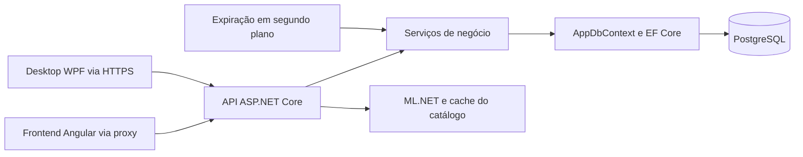
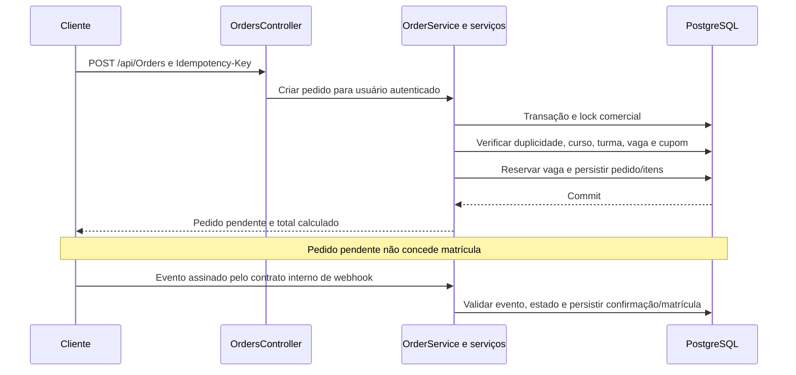

# Arquitetura do PIM4API — MediShop

Esta documentação descreve o código atual da API e suas relações com o site e os demais clientes. A documentação do modelo relacional está em [Banco de dados e DER](BANCO-DE-DADOS.md). A [visão conjunta do sistema](../../PIM4Front/docs/ARQUITETURA.md) detalha também frontend e implantação.

## 1. Estilo arquitetural e limites

O PIM4 é cliente-servidor. A API ASP.NET Core é o componente central de negócio e persistência, organizada como um monólito em camadas lógicas. Ela recebe JSON por HTTP/HTTPS, aplica autorização e regras de negócio e acessa PostgreSQL com EF Core.

Controllers, DTOs, serviços, entidades e acesso a dados estão no mesmo projeto `backend`. Os serviços utilizam `AppDbContext` diretamente. As camadas são responsabilidades do código; não existem projetos separados de domínio/aplicação/infraestrutura ou um repository próprio para cada entidade.



O frontend e o desktop não precisam de credenciais do banco. O mobile é um consumidor previsto/registrado na documentação do conjunto, mas seu código não está disponível nesta instalação e não foi validado nesta revisão.

## 2. Estrutura do projeto

```text
backend/
├── Controllers/     # endpoints, autorização e respostas HTTP
├── DTOs/            # contratos de entrada e saída
├── Services/        # regras de negócio, transações e tarefas
├── Models/          # entidades persistidas
├── Data/            # DbContext e configuração da conexão
├── Migrations/      # evolução do schema e snapshot
├── Validation/      # validações compartilhadas de perfil
├── Program.cs       # composição e middleware
└── Dockerfile       # build e execução do serviço
backend.Tests/       # testes de serviços, autorização e concorrência
```

O `Program.cs` configura os serviços e o pipeline HTTP: headers de proxy confiável, tratamento de exceções, identificação/log da requisição, HTTPS conforme ambiente, CORS, autenticação, rate limiting, autorização e rotas. A confiança no proxy precisa refletir a hospedagem real.

## 3. Responsabilidades e contratos

| Módulo                | Controllers/serviços                                                        | Responsabilidade                                                           |
| --------------------- | --------------------------------------------------------------------------- | -------------------------------------------------------------------------- |
| Conta                 | `AuthController`, `AuthService`, `TokenService`                             | Cadastro, login, perfil, JWT, refresh, revogação e bloqueio de tentativas  |
| Catálogo              | `CoursesController`, `CourseService`                                        | Cursos, turmas, catálogo, interesse e conteúdo educacional                 |
| Comercial             | `OrdersController`, `OrderService`, `InventoryService`, `PromoCodeService`  | Pedido, preço, desconto, reserva, cancelamento, reembolso interno e estado |
| Pagamento             | `PaymentsController`, `OrderService`                                        | Assinatura do webhook interno, idempotência e transição financeira         |
| Aluno                 | `StudentsController`, `MeController`, `StudentService`, `EnrollmentService` | Alunos, matrículas e recursos associados                                   |
| Estado e participação | `EnrollmentStateService`, `ParticipationService`                            | Alterações de matrícula, vagas e confirmação de participação               |
| Auditoria             | `AuditController`, `AuditService`                                           | Consulta e registro das alterações                                         |
| Recomendações         | `CourseRecommendationsController`, `CourseRecommendationEngine`             | TF-IDF, K-Means, cache e sugestões públicas                                |
| Expiração             | `PendingOrderExpirationService`                                             | Encerramento de reservas pendentes vencidas                                |

Os DTOs definem os dados aceitos/enviados. O contrato implementado deve ser conferido nos controllers e no OpenAPI gerado em Development. Documentos estáticos de planejamento podem conter recursos ainda previstos.

## 4. Autenticação e autorização

O login fornece access token JWT, refresh token e perfil. Os clientes usam `Authorization: Bearer` para operações protegidas. O cadastro público cria role `Cliente`; operações administrativas exigem `Admin`. Consultas do aluno verificam seu vínculo com pedido, matrícula ou curso.

Senhas são verificadas com BCrypt. O serviço persiste hashes de refresh tokens e controla sua rotação e revogação. A revogação impede novas renovações da sessão correspondente; o access token emitido permanece sujeito ao seu prazo de validade, sem blacklist em tempo real nesta versão.

Limites de requisição existem para autenticação, criação de pedido e webhook. Os valores efetivos e os caminhos abrangidos estão no `Program.cs`. CORS controla origens de navegador permitidas; não substitui JWT ou autorização dos recursos.

## 5. Pedido, reserva e pagamento



O preço e o desconto são calculados com os dados do servidor. Uma chave já utilizada pelo mesmo usuário permite recuperar o pedido existente. Eventos financeiros repetidos são tratados para preservar a matrícula e as vagas.

`MutationTransaction` inicia a transação e aplica `pg_advisory_xact_lock` no PostgreSQL. As mutações comerciais que usam esse componente são serializadas entre instâncias no mesmo banco. O objetivo é consistência de pedidos, vagas e cupons; o custo é menor paralelismo de escrita. Operações devem permanecer curtas e chamadas a provedores externos exigem desenho próprio.

O worker de expiração verifica pedidos pendentes e libera reservas conforme a regra. Aprovação tardia de pedido encerrado requer conciliação. Alterar o status diretamente no banco ignora esses serviços.

O webhook atual é interno e assinado com HMAC. Integração de cobrança e estorno real depende do provedor; a atualização de um estado interno não comprova movimentação financeira externa.

## 6. Modelo relacional

O modelo EF Core possui 21 entidades/tabelas de aplicação e 166 colunas; o histórico técnico do EF acrescenta uma tabela e duas colunas. Foram identificadas 29 FKs e 35 índices além das PKs. O modelo corresponde ao snapshot das migrations nesta revisão.

O [DER completo e dicionário de dados](BANCO-DE-DADOS.md) documenta o esquema por domínio, com tipos PostgreSQL, nulabilidade, chaves, exclusão e índices. O [DDL de referência](esquema-referencia.sql) foi gerado sem registros e sem execução em banco; atualizações de instalações usam migrations.

Algumas associações são da aplicação: `Students.CourseId` é texto legado, `CourseProgresses.CourseId` não possui FK de curso no modelo atual e `CompletedLessons` é serializado em `text`. Esses campos não devem produzir FKs fictícias no DER.

## 7. ML e conteúdo educacional

O recomendador treina K-Means com metadados públicos dos cursos ativos, guarda grupos/vetores em memória e filtra a disponibilidade das sugestões a cada consulta. O cache não adiciona tabelas. Estados sem sugestões são explicados ao cliente. Consulte [Machine Learning](MACHINE-LEARNING.md) para dados, limites e testes.

Módulos, aulas, progresso, avaliações e certificados têm entidades e endpoints. O fluxo atual de criação de ofertas está limitado ao presencial; a presença dessas estruturas não equivale a uma oferta comercial EAD homologada.

## 8. Implantação e operação

O Dockerfile compila/publica a aplicação com SDK .NET 10 e executa em runtime ASP.NET 10. O Compose local sobe PostgreSQL, API e frontend; o banco usa volume e porta local restrita. Os Blueprints dos repositórios configuram os serviços no Render.

A conexão e os segredos são recebidos por configuração do ambiente. Migrations são aplicadas em Development e, fora dele, quando a opção correspondente é habilitada. `/health` verifica conectividade com o banco e `/health/live` verifica o processo. Saúde não comprova todos os fluxos de negócio nem a totalidade do schema.

O [guia de CI/CD](CI-CD.md) descreve build, testes, PostgreSQL isolado, auditoria, CodeQL, artefatos e verificação de containers. A homologação dos serviços existentes e a ativação das regras remotas devem ser conferidas no ambiente. Backup, restauração, monitoramento e recuperação do banco possuem procedimentos próprios.

## 9. Referências de implementação

- `backend/Program.cs`: composição e middleware.
- `backend/Controllers`, `DTOs`, `Services` e `Validation`: contratos e regras.
- `backend/Models`, `Data/AppDbContext.cs` e `Migrations`: modelo e evolução do banco.
- `docker-compose.yml`, `backend/Dockerfile` e `render.yaml`: execução e hospedagem.
- [Banco/DER](BANCO-DE-DADOS.md), [ML](MACHINE-LEARNING.md), [CI/CD](CI-CD.md) e [README](../README.md).
