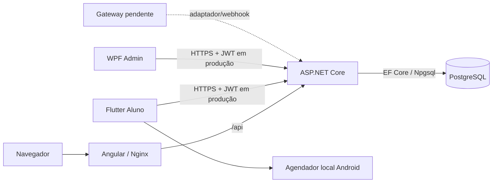
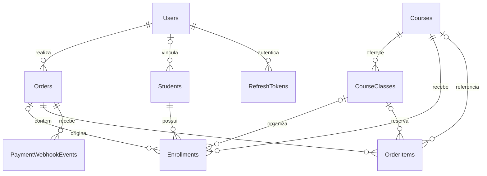

# Revisão completa — MediShop / PIM4

> **Atualização de 24/10/2026:** os achados abaixo descrevem o estado histórico da revisão. Consulte [as correções aplicadas e pendências atuais](CORRECOES-AUDITORIA-2026-10-24.md) antes de interpretar um problema como ainda aberto.

Referência: **17/10/2026**. Projetos: **PIM4Front, PIM4API, PIM4Mobile e PIM4Desktop**.

Esta revisão combina leitura dos fontes, metadados do PostgreSQL local, testes e builds. Não representa homologação de uma instalação pública. As mudanças locais precisam ser revisadas e versionadas nos respectivos repositórios.

## 1. Estado geral

O fluxo presencial principal já existe: cadastro/login, catálogo, seleção de turma, pedido, confirmação de pagamento pelo contrato interno de webhook, geração de matrícula e acesso do aluno. Web, Android e desktop consomem a mesma API; apenas ela acessa o banco.

**Há base funcional para demonstração controlada com pagamento simulado. A entrega para vendas reais ainda depende de integração financeira e correções descritas neste relatório.** Não é tecnicamente útil atribuir um percentual único: telas concluídas e uma integração financeira ausente têm pesos diferentes.

| Área | Implementado | Falta para entrega final |
| --- | --- | --- |
| Site público | Home, catálogo, detalhes, carrinho e conta | Deploy, URL pública da API e atualização de dependências |
| Aluno web | Matrículas, detalhes, contagem e confirmação | Homologação no ambiente público |
| Admin web | Cursos/turmas/alunos/cupons/pedidos/auditoria | Integridade de vagas e concorrência em operações específicas |
| API | Regras centrais, autorização e 62 operações HTTP identificadas | Gateway, correções de consistência/sessão/proxy e operação pública |
| Banco | PostgreSQL, migrations, Products removida | Backup operacional, restauração ensaiada e acesso restrito |
| Android | Flutter real, conta, matrículas, pedidos e lembretes locais | Teste nativo, assinatura release e distribuição |
| Desktop | WPF administrativo compilado, cobertura parcial do web | Configuração pública e homologação em outro Windows |
| Pagamentos | Estado interno e webhook HMAC de teste | Cobrança, webhook e estorno reais com o provedor |
| Infraestrutura | Compose local e blueprint Render API/banco | Front público, HTTPS, segredos, monitoramento e deploy efetivo |

**Implementado** significa código existente; **validado** significa uma verificação descrita adiante. **Risco por inspeção** identifica um caminho de código, sem afirmar que a falha foi reproduzida em carga ou produção.

## 2. Documentação complementar

| Arquivo | Conteúdo |
| --- | --- |
| [Inventário técnico](INVENTARIO-TECNICO-2026-10-17.md) | Rotas, tabelas, todas as colunas, restrições, índices, migrations e métodos públicos reconhecidos |
| [Inventário JSON](INVENTARIO-TECNICO-2026-10-17.json) | Metadados estruturados para consulta |
| [Participação e notificações](NOTIFICACOES-E-PARTICIPACAO.md) | Contrato, prazos, configuração e limites Android |
| [Auditoria npm completa](AUDITORIA-DEPENDENCIAS-WEB-2026-10-17.json) | Inclui dependências de desenvolvimento |
| [Auditoria npm de produção](AUDITORIA-DEPENDENCIAS-PRODUCAO-WEB-2026-10-17.json) | Consulta omitindo dependências de desenvolvimento |
| [Fluxo de desenvolvimento](../FLUXO-DE-DESENVOLVIMENTO.md) | Decisões e histórico; registros novos substituem decisões antigas |
| [README API](../README.md) | Configuração e operação |
| [README web](../../PIM4Front/README.md) | Angular, rotas, execução e testes |
| [README mobile](../../PIM4Mobile/README.md) | Flutter, prévia web e APK |
| [README desktop](../../PIM4Desktop/README.md) | WPF, configuração e distribuição |

O inventário não exporta alunos, senhas, tokens ou segredos. A enumeração de funções usa leitura estática, não análise semântica completa: auxiliares, lambdas e propriedades podem não aparecer. O mapa funcional abaixo complementa a lista de nomes/arquivos.

## 3. Arquitetura e tecnologias

Front, desktop e mobile não precisam da senha do banco. Guards de navegação não substituem autorização na API.

| Camada | Tecnologia/versão observada |
| --- | --- |
| Site | Angular 21.2.x, TypeScript 5.9.x, RxJS 7.8.x, HTML/SCSS, lucide-angular |
| Testes web | Vitest, jsdom, Playwright e script PowerShell E2E |
| Build/entrega web | npm/package-lock, Angular CLI, Docker Node 24 e Nginx |
| API | C#, ASP.NET Core, alvo .NET 10 |
| Persistência | Entity Framework Core 10.0.11, Npgsql 10.0.3 |
| OpenAPI/JWT ASP.NET | Pacotes 10.0.12; System.IdentityModel.Tokens.Jwt 8.19.2 |
| Senha | BCrypt.Net-Next 4.0.3 |
| Banco | PostgreSQL 17; imagem 17-alpine no Compose |
| Mobile | Flutter 3.47.7, Dart 3.13.5, Material 3, pt-BR |
| Cliente mobile | http, flutter_secure_storage, url_launcher, intl, flutter_localizations |
| Lembretes | flutter_local_notifications 22.3.2, timezone 0.11.2 |
| Android | Java 17, SDK/build-tools 36; APK mínimo API 24, alvo API 36 |
| Desktop | .NET 10 Windows, WPF/XAML, C#, HttpClient e ViewModel |
| Infra | Docker Compose, volume PostgreSQL, Nginx e blueprint Render |
| Automação | Workflows de teste/build e CodeQL onde existentes; mobile sem CI equivalente encontrado |

São versões do ambiente/manifestos auditados, não uma afirmação de que sejam as últimas. O ambiente local usou Node 24.21.0; o CI web declara Node 22 e o Docker, Node 24. Padronizar reduz diferenças.

### Organização dos fontes

| Caminho | Responsabilidade |
| --- | --- |
| API/backend/Controllers e DTOs | Contratos HTTP, entrada/saída e autorização |
| API/backend/Services | Regras de negócio, pedido, vaga, matrícula e participação |
| API/backend/Models, Data e Migrations | Entidades, EF e evolução do schema |
| Front/src/app/features | Telas públicas, conta, checkout, aluno e admin |
| Front/src/app/core | Autenticação, clientes HTTP, guards e configuração |
| Front/src/app/shared | Componentes comuns, incluindo agenda/participação |
| Mobile/lib/core | Sessão, API, modelos e sincronização dos lembretes |
| Mobile/lib/ui | Telas e componentes Flutter |
| Mobile/android e scripts | Integração nativa, permissões, build e prévia |
| Desktop/Services | Cliente HTTP e JWT |
| Desktop/ViewModels e Configuration | Estado administrativo e resolução da URL da API |

## 4. Site e administração

### 4.1 Público, compra e aluno

| Função | Comportamento atual | Limite |
| --- | --- | --- |
| Home | Apresentação e entrada para formação/catálogo | Textos repetidos/layout revisados nas etapas anteriores |
| Catálogo | Busca, filtros, paginação e opções da API | Oferta atual de cursos presenciais ativos |
| Detalhes | Curso e seleção de turmas | Turma deve estar elegível para inscrição |
| Disponibilidade | Situação, início futuro e vagas | Cadastro de turma sozinho não garante oferta |
| Interesse | Registro de interesse em curso | Não é compra nem matrícula |
| Carrinho | Curso vinculado à turma selecionada | API revalida preços/disponibilidade |
| Conta | Cadastro, login, perfil e pedidos | Recuperação de senha não está completa |
| Checkout | Pedido, cupom e meio de pagamento interno | Não efetua cobrança externa |
| Área do aluno | Matrículas, busca/filtro, turma e situação | Acesso depende de matrícula liberada pela API |
| Detalhes da matrícula | Navegação por enrollmentId | Não usa courseId como ID da matrícula |
| Agenda | Contagem, confirmação e retorno persistido | Confirmação não é presença em aula |

Cursos usam **Courses**. **CourseClasses.CourseId** vincula turma ao curso. Products foi removida. Inscrições encerram no horário de início, inclusive no mesmo dia; comparar só a data é insuficiente. Pedido pendente não libera matrícula.

### 4.2 Rotas web

| Rota | Uso | Proteção |
| --- | --- | --- |
| / | Home | Pública |
| /catalogo | Catálogo | Pública |
| /curso/:id | Detalhes | Pública |
| /login | Autenticação | Pública |
| /carrinho | Carrinho | Público; criar pedido exige login |
| /checkout | Checkout | authGuard |
| /conta | Conta/perfil | authGuard |
| /conta/pedido/:id | Pedido próprio | Guard e proprietário na API |
| /area-aluno | Matrículas | authGuard |
| /area-aluno/matricula/:id | Matrícula própria | Guard e proprietário na API |
| /conta/matricula/:id | Caminho antigo | Redireciona à área do aluno |
| /admin | Administração | adminGuard e role na API |
| Outros caminhos | Fallback | Redireciona à home |

### 4.3 Admin web

| Área | Funções existentes |
| --- | --- |
| Dashboard | Indicadores disponíveis a partir dos dados da plataforma |
| Cursos | Criar presencial, listar, editar, arquivar/restaurar |
| Turmas | Criar/editar início, local, instrutor, capacidade e situação |
| Alunos por turma | Matrículas, alteração de status, transferência e confirmação |
| Alunos geral | Cadastro, edição, listagem e exclusão quando não há matrícula |
| Cupons | Consultar, criar, editar, excluir e validar |
| Pedidos | Consultar, alterar situação e registrar reembolso interno |
| Auditoria | Consultar eventos administrativos |
| CSV da turma | Exportar alunos e informação de participação |

Listagem de turmas, nomes longos, campos monetários/percentuais e navegação do aluno receberam ajustes. Não foi realizada uma auditoria visual de todas as resoluções possíveis. As correções de visual não resolvem as inconsistências de vagas descritas adiante.

## 5. API e funções

Foram identificadas **62 operações HTTP**, contando /health. O inventário lista método, rota e grupo de todas elas. A permissão deve ser confirmada nos controllers e nas verificações de proprietário: ausência de security no OpenAPI não significa acesso público.

### 5.1 Autenticação

| Função | Implementação |
| --- | --- |
| Cadastro | Validação/normalização de e-mail, CPF e senha |
| Login | BCrypt, JWT e refresh token |
| Refresh | Hash no banco, expiração, rotação e revogação |
| Logout servidor | Revoga refresh tokens conforme política implementada |
| Perfil | Leitura/edição do usuário autenticado |
| Admin | Role Admin nas operações administrativas |
| Aluno | Restrição ao proprietário de matrícula/pedido |

Controles encontrados: senha mínima de 12 caracteres com maiúscula/minúscula/número; bloqueio após tentativas inválidas; validação de emissor/audiência/assinatura/validade JWT; segredo com tamanho mínimo; refresh armazenado como hash SHA e duração de 30 dias no caminho observado.

Logout ou alteração de papel não torna instantaneamente inválido todo JWT de acesso já emitido: ele pode durar até a expiração. Não foi encontrado fluxo completo de recuperação de senha ou verificação de e-mail.

### 5.2 Mapa funcional dos serviços

| Serviço / métodos | Responsabilidade | Limite ou atenção |
| --- | --- | --- |
| CourseService.GetCatalogAsync / GetCatalogOptionsAsync | Catálogo e filtros | Disponibilidade e modalidade |
| CourseService.CreateAsync / UpdateAsync / SetActiveAsync | Cadastro, edição e ativação | Criação atual restrita a presencial |
| CourseService.CreateClassAsync / UpdateClassAsync | Turma e capacidade | Mudança de início invalida confirmação |
| CourseService.GetClassStudentsAsync | Alunos/matrículas da turma | Inclui participação |
| CourseService.UpdateEnrollmentStatusAsync | Status acadêmico da matrícula | Possui lógica própria de vagas |
| CourseService.TransferEnrollmentAsync | Transferência entre turmas | Rever refund e concorrência |
| CourseService: módulos/aulas/avaliações/questões | Conteúdo EAD | Legado/condicional; não oferta EAD comercial habilitada |
| StudentService | CRUD do cadastro de aluno | Atualização geral diverge da lógica de vagas por turma |
| OrderService.CreateAsync | Pedido, reserva, totalização e idempotência | Não cria cobrança externa |
| InventoryService.ValidateAndReserveAsync | Validação e reserva de vagas | Atualização condicional na reserva de checkout |
| OrderService.ProcessPaymentWebhookAsync | Evento e transição financeira | Contrato próprio, não adaptador universal de gateway |
| OrderService.CancelAsync / ExpirePendingOrdersAsync | Encerrar pendência e liberar reserva | Revisar transições concorrentes |
| OrderService.RefundAsync | Reembolso interno e cancelamento de matrícula | Não devolve dinheiro no provedor |
| EnrollmentService | Criar matrículas após aprovação | Quantidade maior que um usa o mesmo aluno comprador |
| ParticipationService.Describe / ConfirmAsync | Prazo e confirmação | Proprietário, turma e início validados no servidor |
| AuditService.Add | Registrar ação/antes/depois | Revisar ID definitivo em criação |
| PendingOrderExpirationService | Expirar pedidos pendentes | Não envia notificações Android |

O inventário inclui arquivos e métodos reconhecidos para localizar cada implementação. Métodos com nomes semelhantes em controllers, serviços e clientes não são funcionalidades independentes: representam camadas do mesmo fluxo.

### 5.3 Participação

Contratos principais: GET /api/me, GET /api/me/courses, GET /api/me/enrollments/{id} e POST /api/me/enrollments/{id}/participation. A resposta inclui participation com status, opensAt, confirmedAt e canConfirm.

| Estado | Significado |
| --- | --- |
| waiting | Janela ainda não abriu |
| pending | Pode confirmar |
| confirmed | Confirmação válida para o início atual |
| closed | Prazo/situação sem nova confirmação |
| unavailable | Matrícula ou turma indisponível |
| not_applicable | Sem turma presencial aplicável |

A janela abre **168 horas antes** e fecha no início. Nova confirmação exige matrícula ativa e turma agendada. Repetição preserva o timestamp. Respostas: 401 sem login; 404 para matrícula inexistente/de outro usuário; 409 fora da janela ou indisponível.

Gravação condicional vincula a confirmação à turma/data conferidas. Mudança de início, cancelamento, transferência e reativação após cancelamento invalidam confirmação anterior. Confirmar não significa presença, conclusão ou pagamento. Não confirmar não cancela automaticamente a matrícula nem libera vaga.

## 6. Pedido, pagamento e matrícula

### Fluxo implementado

1. Cliente seleciona curso e turma no site.
2. Checkout envia itens; API revalida preço, início, situação e vagas.
3. Cupom elegível é aplicado; pedido pendente é salvo com reserva.
4. Evento autenticado chega ao webhook interno.
5. Aprovação registra pagamento e cria matrículas.
6. Aluno consulta no web/mobile e, na janela, confirma participação.

OrderItems guarda snapshots de nome/preço, preservando o histórico da compra quando o cadastro do curso muda.

O endpoint /api/payments/webhook possui HMAC, EventId, OrderId, PaymentId, status e registro do processamento. Repetição sequencial é tratada; assinatura inválida é rejeitada, e falta de segredo não deve liberar confirmação.

**Isso permite testar o ciclo interno. Não constitui integração pronta com HostGator ou qualquer outro gateway.** Assinatura, corpo, identificação, consulta de cobrança e confirmação de valores devem seguir o produto efetivamente contratado.

| Entrega financeira | Estado | Critério para finalizar |
| --- | --- | --- |
| Provedor contratado | Não configurado | Conta/documentação do produto exato |
| Segredos sandbox/produção | Não integrados | Configuração fora do Git |
| Criar cobrança externa | Ausente | Persistir identificador e retorno do provedor |
| Pix/cartão/boleto | Seleção interna não prova cobrança | Implementar apenas meios contratados |
| QR Code/redirecionamento | Dependente do gateway | Instrução real de pagamento ao aluno |
| Webhook externo | Adaptador pendente | Conferir assinatura, pedido, valor/moeda e cobrança |
| Duplicação/ordem de eventos | Base sequencial existe | Testar eventos concorrentes e fora de ordem |
| Pagamento tardio | Há rejeição se reserva encerrou | Conciliação/estorno/reabertura definidos |
| Reembolso financeiro | Ausente | Provedor confirma devolução e API acompanha |
| Conciliação | Processo externo incompleto | Detectar e resolver divergências |

O status local refunded não comprova devolução de dinheiro. A hospedagem escolhida não define automaticamente o gateway. O desenho final deve usar o mecanismo de checkout/tokenização do produto contratado, sem guardar dados completos de cartão na aplicação.

## 7. Banco de dados

### 7.1 Estrutura real

Foram inventariadas **22 tabelas incluindo __EFMigrationsHistory**, portanto **21 tabelas de domínio**, e **168 colunas** no total. O apêndice contém todos os tipos, nulabilidade, restrições e índices encontrados.

| Tabela | Finalidade e vínculos |
| --- | --- |
| Users | Conta, autenticação, papel e perfil |
| Students | Aluno; UserId nullable; cadastro manual não cria conta automaticamente |
| Courses | Curso, oferta e conteúdo |
| CourseClasses | Turma, início, capacidade, vagas e situação; FK para Courses |
| Enrollments | Aluno/curso/turma/pedido e confirmação de participação |
| Orders | Pedido, usuário, situação financeira, datas e idempotência |
| OrderItems | Curso/turma, quantidade e snapshots; CourseId nullable preserva histórico |
| PromoCodes | Desconto, restrições e contador/limite de uso |
| RefreshTokens | Hash, expiração e revogação de sessão |
| PaymentWebhookEvents | Identidade do evento, pedido e processamento |
| AuditLogs | Usuário/ação/entidade e valores anteriores/novos |
| CourseInterests | Interesse, sem substituir compra |
| CourseModules | Módulos de curso EAD |
| CourseLessons | Aulas de módulos |
| CourseProgresses | Progresso e aulas concluídas |
| CourseAssessments | Avaliações |
| CourseQuestions | Questões |
| CourseQuestionOptions | Alternativas |
| CourseAssessmentAttempts | Tentativas e resultados |
| CourseAssessmentAnswers | Respostas da tentativa |
| CourseCertificates | Registro de certificado |
| __EFMigrationsHistory | Migrations aplicadas |

O diagrama resume relações de negócio. Para restrições SQL, nomes exatos, nulabilidade e exclusão, prevalece o inventário do banco.

### 7.2 Legado e migrations

- Products não está presente no schema final.
- CourseClasses.CourseId aponta para Courses.
- OrderItems preserva descrição/preço sem depender de Products.
- Namespace EquipamentosMedicosApi e nomes antigos são dívida de organização, não prova de Products ativa.
- CourseClasses persiste **VafasDisponiveis** e **AvailableSeats**; a duplicação/alias de compatibilidade exige sincronização e futura normalização.
- Students.CourseId tem informação textual legada; a relação acadêmica efetiva deve ser consultada em Enrollments.

Última migration aplicada: **20261017164427_AddParticipationConfirmation**, com dois campos nullable em Enrollments: ParticipationConfirmedAt e ParticipationStartDate. Não recria o banco. A migration provisória Firebase foi retirada antes da aplicação; o schema final não possui tabelas de dispositivos push.

Backup anterior: `.local-backups/before-participation-20261017-121030.dump`, pasta ignorada no Git. Esse backup não substitui rotina automática nem ensaio de restauração em banco separado.

### 7.3 Preparação de dados

| Item | Pendência |
| --- | --- |
| Seeds/dados fictícios | Revisar alunos e cupons de exemplo antes de uso público |
| Credenciais | Substituir valores de desenvolvimento |
| Backup | Frequência, retenção, proteção e responsável |
| Restauração | Executar em ambiente isolado e documentar |
| Migrations | Backup, ordem de aplicação e reversão; coordenar múltiplas instâncias |
| Vagas | Centralizar reserva/liberação e corrigir caminhos divergentes |
| Dados pessoais | Definir acesso, retenção e atendimento |
| Banco público | Restringir rede/usuários e evitar exposição indiscriminada |

## 8. Aplicativo Flutter Android

### 8.1 Entrega funcional

| Recurso | Implementação |
| --- | --- |
| Login | Conta da mesma API/site |
| Sessão | Armazenamento seguro de tokens, sem senha |
| Refresh | Uma renovação compartilhada e proteção contra restauração após logout |
| Matrículas | Lista, totais, busca e filtros |
| Detalhes | ID da matrícula, curso, turma, data, local, instrutor e status |
| Pedidos | Listagem/detalhes, itens, valores e pagamento |
| Perfil | Edição de dados, contato e endereço |
| Compra/cadastro | Abre o site; sem checkout nativo no escopo |
| Interface | Carregamento, vazio, erro, retry e atualização |
| Participação | Contagem e confirmação pela API |
| Lembretes | Ativação/teste no perfil e agendamento local |
| Toque no aviso | Abre matrícula após login; verifica conta |

Não há administração nativa, player EAD nativo, modo offline completo ou fila offline de alterações. Manter aviso previamente agendado não torna todo o aplicativo offline.

### 8.2 Notificações locais, sem Firebase

Esta é a decisão final do usuário. A API/banco/site continuam hospedados normalmente; **o Android apresenta o aviso agendado no próprio aparelho**. Não há worker de push na API, projeto Firebase ou credencial Firebase a configurar.

| Evento | Comportamento |
| --- | --- |
| Ativar no perfil | Solicita permissão no sistema quando necessário |
| Planejamento normal | Sete dias antes, apenas matrícula ativa/turma agendada futura |
| Primeira entrada na semana | Aviso próximo, após cerca de dez segundos |
| Conteúdo | Curso, data/horário local e local da turma |
| Identidade | Matrícula e conta do aluno |
| Sincronização | Lista/detalhes e retorno ao app consultam alterações |
| Mudança de início/local | Atualiza aviso ao sincronizar |
| Confirmação/cancelamento | Cancela lembrete correspondente |
| Logout/desativar | Cancela avisos locais |
| Histórico | Impede repetição a cada atualização |
| Testar notificação | Não substitui nem consome lembrete da turma |
| Reinício Android | Receivers configurados para reconstituir agendamentos |

Arquivos principais: lib/core/reminder_device.dart (plugin/plano), lib/core/course_reminders.dart (conta, fila e sincronização), lib/ui/reminder_settings.dart (perfil) e lib/ui/enrollment_schedule.dart (contagem/confirmação).

O modo é **inexactAllowWhileIdle**, sem permissão de alarme exato. Economia de bateria, fabricante e permissão podem atrasar/impedir entrega. Mudança feita pelo admin só atualiza o aviso quando o app sincroniza novamente; sem rede, preserva o agendamento conhecido. Esse limite é próprio da opção local escolhida.

Testes usam dispositivo/armazenamento substitutos. Entrega visual, permissão real, reinício e abertura com app encerrado **ainda precisam de Android físico/emulador**.

### 8.3 Prévia e builds

http://localhost:4300 executa **o próprio Flutter compilado para web**, em moldura de celular. Não é réplica HTML nem emulador Android. Valida telas/navegação/API, sem reproduzir alarmes nativos.

Preview-Mobile.ps1 compila em profile; servidor Node escuta somente loopback, entrega /app/ e encaminha /api para 5278. Não altera o CORS de produção.

APK: `PIM4Mobile/build/app/outputs/flutter-apk/app-debug.apk`. Pacote br.com.medishop.pim4_aluno, versão 1.0.0+1. Build de desenvolvimento usa URLs locais: IP deve corresponder ao PC da API. Produção exige HTTPS público, assinatura própria, release/AAB conforme distribuição e homologação nativa.

kotlin.incremental=false permanece por conflito de cache entre dependências no C: e projeto no D:. APK debug não é entrega final de loja.

## 9. Desktop Windows

| Área | Disponível | Diferença para o web |
| --- | --- | --- |
| Login | Conta Admin e JWT | Mesmo servidor |
| Dashboard | Cursos ativos, pendências, alunos e receita | Não é sistema financeiro completo |
| Cursos | Listar, criar presencial, arquivar | Edição/restauração não têm toda a interface web |
| Turmas | Listar e criar | Data sem campo completo de hora/término |
| Alunos | Consultar | Sem CRUD integral |
| Cupons | Consultar/criar | Sem toda a edição/exclusão web |
| Pedidos | Consultar cliente, status e valores | Sem cobrança externa |
| Auditoria | Consultar | Depende dos eventos gerados pela API |
| EAD | Listar cursos existentes | Sem editor completo de conteúdo |
| Atualização | Manual e após cadastro | Várias consultas em paralelo |

O desktop não tem paridade completa com o admin web. Transferência, confirmação de participação e operações avançadas requerem interface própria se forem exigidas nesse cliente.

### Comunicação e distribuição

PIM4_API_BASE_URL pode definir a URL; a configuração também lê appsettings.json e possui fallback local. O cliente usa HttpClient/JWT, não PostgreSQL. **localhost no computador do cliente aponta para o próprio cliente**, não para o servidor.

Antes de distribuir: configurar URL pública HTTPS, escolher pacote com/sem runtime, testar em Windows sem SDK e definir canal de instalação/atualização. A configuração atual aceita URI absoluta; revisar exigência de HTTPS na entrega final.

Build Release aprovado, sem warnings/erros na execução registrada. Não houve teste em outro Windows nem suíte automatizada de comportamento WPF encontrada. Compilar não comprova instalação/navegação.

O formulário de turma usa apenas data. Sem horário explícito, há risco de início à meia-noite e encerramento antecipado das inscrições. Para início com hora precisa, usar o web até alinhar o desktop. A renovação concorrente de sessão requer ajuste descrito abaixo.

## 10. Docker, hospedagem e operação

### 10.1 Compose local

| Serviço | Porta host/interna | CPU máxima padrão | Memória máxima padrão |
| --- | --- | --- | --- |
| PostgreSQL | 5432/5432 | 2,0 | 1024 MB |
| API | 5278/8080 | 2,0 | 1024 MB |
| Front/Nginx | 4200/80 | 0,5 | 256 MB |

Variáveis: POSTGRES_CPUS, POSTGRES_MEMORY_LIMIT, API_CPUS, API_MEMORY_LIMIT, FRONTEND_CPUS e FRONTEND_MEMORY_LIMIT. Há também configuração de portas/banco. Limites não são consumo fixo nem reserva garantida. O limite global Docker/WSL é independente; não foi alterado nesta etapa.

postgres-data persiste dados entre recriações. Atualização normal não deve remover o volume. A API depende do healthcheck do PostgreSQL no Compose. Reiniciar só a API com banco parado não substitui subir a dependência. Na conferência final, Compose iniciou novamente os serviços e os endpoints locais retornaram saudáveis.

| Ambiente | Caminho da API |
| --- | --- |
| Angular dev | /api por proxy para localhost:5278 |
| Compose | Nginx → api:8080, nome interno da rede Docker |
| Flutter preview | localhost:4300/api → localhost:5278 |
| Android | IP da rede/emulador ou domínio público |
| Desktop | URL em variável/arquivo |
| Produção | Domínio HTTPS e proxy /api ou configuração absoluta |

### 10.2 Render

render.yaml descreve **API + PostgreSQL**, sem serviço frontend. O plano declarado é de demonstração; disponibilidade/preço/limites atuais precisam ser verificados no provedor no momento do deploy.

O frontend usa /api e Nginx apontando a api:8080. Esse nome resolve no Compose, não automaticamente em serviços separados no Render. Configurar proxy público ou endereço absoluto e CORS antes de publicar.

O blueprint prevê Production, migrations no início, segredo JWT, origem CORS a preencher e variáveis de conexão do banco. Não cria conta de gateway nem integra cobrança.

| Entrega operacional | Critério de conclusão |
| --- | --- |
| Ambiente público | Site/API/banco funcionando nos endereços definitivos |
| TLS | Certificado válido e HTTPS externo |
| Proxy/CORS | Origens explícitas, sem depender de DNS local Docker |
| Segredos | Fora do Git, acesso restrito e rotação |
| Admin | Provisionamento seguro sem conta temporária exposta |
| Banco | Rede/usuário restritos; porta sem exposição ampla |
| Backup | Rotina e restauração ensaiadas |
| Observabilidade | Logs/alertas de erro, indisponibilidade e pagamento |
| Deploy | Processo reproduzível com migrations e reversão |
| Apps | Builds públicos homologados fora da rede local |

## 11. Segurança e dependências

### Controles presentes

BCrypt; JWT validado; refresh com hash/rotação; role Admin; proprietário em recursos do aluno; HMAC no webhook; rate limiting; CORS explícito em produção; corpo Kestrel limitado a 1 MB; OpenAPI em desenvolvimento; HTTPS exigido no mobile release.

Isso não elimina riscos de concorrência, proxy e sessão. Não houve pentest externo nem avaliação de uma aplicação publicada.

### Auditoria npm — 17/10/2026

| Consulta | Pacotes afetados reportados | Severidade |
| --- | --- | --- |
| Completa | 30 | 3 críticos, 16 altos, 9 moderados, 2 baixos |
| Omitindo dev | 6 | 4 altos, 2 moderados, nenhum crítico |

São contagens de pacotes do relatório, não 30 falhas diferentes comprovadamente exploráveis. A consulta completa inclui ferramentas de desenvolvimento. Em produção, common/compiler/core/router Angular aparecem como altos; forms/platform-browser, moderados.

Há avisos de sanitização/XSS e caminhos de SSR/cache. O projeto observado é SPA/Nginx, sem SSR, portanto nem todos os cenários dos advisories se aplicam. É necessário fazer triagem, atualizar versões compatíveis em conjunto e testar. Não foi executado npm audit fix ou atualização ampla junto dos lembretes.

A consulta NuGet da API, incluindo transitivas, não listou vulnerabilidades conhecidas no resultado retornado. Não é garantia de ausência de falhas desconhecidas. Não houve auditoria completa equivalente da cadeia Android/Flutter.

## 12. Validação realizada

| Camada | Resultado | Limite |
| --- | --- | --- |
| API | **82 testes aprovados** | Sem teste de carga/concorrência real PostgreSQL |
| Front | **52 testes aprovados** | Sem cobertura de toda resolução/navegador |
| Flutter | **20 aprovados e 1 opcional pulado** | Dispositivo/armazenamento de notificação substitutos |
| Flutter analyze | Sem problemas | Não comprova alarme/permissão nativos |
| Build web | Aprovado | Avisos existentes de orçamento de estilos |
| Flutter web profile | Gerado | Não é emulação Android |
| APK debug | Gerado | Sem homologação nativa/release de loja |
| Manifest APK | Permissões e receivers de notificação/reinício conferidos | Presença no manifest não prova entrega |
| Desktop Release | Compilado sem warnings/erros na execução registrada | Sem outro Windows |
| Migration | Aplicada no PostgreSQL local | Sem ambiente de produção |
| E2E completo anterior | Pedido/pagamento assinado/matrícula aprovado | Pagamento interno simulado |
| Participação integrada | Web + Flutter web + API/banco aprovados | Sem alarme Android real |
| Saúde local final | API /health, site e preview saudáveis | Não é monitoramento contínuo |

### Cenário integrado de participação

Usuários/cursos fictícios e API/PostgreSQL reais foram usados para verificar: matrícula após pedido/pagamento simulado; 401 anônimo; 404 outro proprietário; confirmação pela interface web; persistência e timestamp idempotente; consulta admin; invalidação após mudar início; confirmação pela interface Flutter web; vagas inalteradas.

Após teste, cursos fictícios foram arquivados, administradores temporários despromovidos e fixture de credenciais removida. Histórico de pedido foi preservado.

Testes dos lembretes incluem planejamento, exclusão de EAD/canceladas/confirmadas, atualização, ausência de repetição, cancelamento, permissão recusada, toque de outra conta, expiração de sessão sem travar e consulta de uma matrícula sem apagar avisos das outras.

### E2E que travava

Foi identificado e corrigido um GET inicial de cursos atrasado que substituía o estado recém-atualizado do admin. O novo controle de revisão preserva curso/turma criados, com regressões e execução integrada sob atraso controlado.

Isso não torna futuras falhas automaticamente erro da aplicação: serviços, credenciais, rate limit e configuração continuam pré-condições. O registro histórico está no fluxo/README web.

## 13. Achados e correções necessárias

As prioridades são de planejamento. Cenários deduzidos por inspeção abaixo não foram todos reproduzidos sob carga; testes sequenciais aprovados não comprovam segurança de concorrência.

### 13.1 Alta — pagamento real ausente

**Referência:** backend/Services/OrderService.cs e controllers/DTOs de Orders/Payments.

Há ciclo interno, mas não criação de cobrança/estorno externos. Não vender interpretando refunded local como dinheiro devolvido. Integrar o produto contratado, conferir assinatura/valor/pedido, conciliar e homologar cobrança/estorno.

### 13.2 Alta — atualizar aluno geral não ajusta vagas

**Referência:** StudentService.UpdateAsync versus CourseService.UpdateEnrollmentStatusAsync.

UpdateAsync propaga status às matrículas, sem executar reserva/liberação equivalente. Cancelar por esse caminho pode continuar ocupando vaga; reativar pode não reservar. Limpeza da confirmação foi implementada, mas não resolve esse contador.

Exclusão de aluno com matrícula é bloqueada: não se trata de remoção irrestrita em cascata.

**Ação:** centralizar transição matrícula/vaga em serviço transacional comum. Testar mesma operação por tela geral e por turma.

### 13.3 Alta — transferência + reembolso pode devolver vaga à turma errada

**Referência:** CourseService.TransferEnrollmentAsync; OrderService.ReleaseStockAsync/RefundAsync e webhook refunded.

Transferência muda Enrollment.ClassId e contadores. OrderItems.TurmaId mantém turma original; refund libera pela turma do item.

**Exemplo deduzido:** compra deixa A em 9/10; transferência deixa A em 10 e B em 9/10; refund pode deixar A em 11/10 e B ainda ocupada, mesmo cancelando matrícula. ReleaseStock incrementa sem teto.

**Ação:** fonte única da reserva atual e liberação uma única vez. Cobrir cancelamento individual anterior ao reembolso. Aplicar apenas teto no contador esconderia a turma errada.

### 13.4 Alta — transições financeiras concorrentes

**Referência:** OrderService, webhook/cancelamento/expiração/reembolso.

Há transação e unicidade de evento, mas leituras/gravações por eventos diferentes do mesmo pedido ainda podem competir. Uma transação comum não serializa automaticamente todo o ciclo por pedido. Testes atuais de idempotência sequencial não cobrem isso.

**Ação:** transições condicionais/serializadas, tratamento de conflitos e testes PostgreSQL de eventos simultâneos, aprovação versus cancelamento e liberação única.

### 13.5 Alta — última vaga em transferência/reativação

**Referência:** CourseService.TransferEnrollmentAsync/UpdateEnrollmentStatusAsync; InventoryService.

Checkout reserva por atualização condicional. Transferência/reativação lê e modifica contador rastreado sem proteção uniforme. Duas operações podem disputar a última vaga e perder atualização/exceder capacidade.

**Ação:** centralizar reserva atômica e testar concorrência real. Transação isoladamente não garante resolver disputa.

### 13.6 Média/alta — idempotência de pedido e uso de cupom

**Referência:** OrderService.CreateAsync e contador de uso de promoção.

Índice único impede pedidos duplicados persistidos, mas duas leituras iniciais podem passar juntas; falta recuperar conflito retornando pedido existente, em vez de erro inesperado. Uso de cupom é incrementado em pedido pendente, com verificação/alteração não uniformemente atômica.

**Ação:** tratar conflito de unicidade; definir se cancelamento/expiração/refund consomem cupom; reserva/consumo condicional e testes de simultaneidade/retry.

### 13.7 Alta no deploy — rate limit atrás de proxy

**Referência:** backend/Program.cs e Front/nginx.conf.

Chave usa Connection.RemoteIpAddress. Não foi encontrado UseForwardedHeaders com proxies confiáveis antes do limitador. Nginx/Render podem fazer vários usuários compartilhar IP e esgotar juntos cinco operações de autenticação por minuto.

**Ação:** configurar proxies/redes confiáveis e processamento de headers antes do limitador; não confiar em IP arbitrário do cliente. Validar pelo acesso público com usuários distintos.

### 13.8 Alta — refresh simultâneo no web/desktop

**Referência:** auth.interceptor/AuthService web e Desktop/Services/ApiClient.cs.

Vários 401 podem renovar separadamente um refresh token de uso único. Uma resposta pode invalidar outra e derrubar sessão/painéis. Desktop faz consultas paralelas. Flutter já compartilha renovação com testes.

**Ação:** uma renovação em andamento, reaproveitada por chamadas pendentes; proteger logout contra resposta atrasada e testar múltiplos 401.

### 13.9 Média — logout web apenas local

**Referência:** AuthService web.

Remove chaves locais sem chamar revogação servidor. Refresh copiado pode continuar válido. Mobile/desktop possuem caminho servidor.

**Ação:** revogar e limpar local mesmo com falha de rede; definir revogação por sessão ou todas as sessões.

### 13.10 Alta de negócio — várias vagas para o mesmo aluno

**Referência:** EnrollmentService, quantidade do item e rotas administrativas por studentId.

Quantidade maior que um gera matrículas do mesmo comprador, sem participantes distintos. Status/transferência por studentId e seleção da primeira matrícula ficam ambíguos nesse caso.

**Ação/decisão:** limitar uma vaga por aluno ou identificar/convidar participantes. Operar por enrollmentId inequívoco nos contratos administrativos.

### 13.11 Média — auditoria de criação com ID não gerado

**Referência:** StudentService.CreateAsync e AuditService.Add.

Student.Id é passado antes de SaveChanges; AuditService converte imediatamente para texto. O evento pode guardar ID padrão em vez do definitivo.

**Ação:** registrar identificador final na mesma transação; revisar outros cadastros com sequência equivalente. Existir AuditLogs não comprova rastreabilidade perfeita.

### 13.12 Alta — dependências com avisos conhecidos

Consultar seção 11/JSONs, fazer triagem e atualizar Angular compatível. Separar desenvolvimento de runtime sem ignorar os seis pacotes da consulta de produção.

### 13.13 Entrega — homologação nativa e externa

APK debug e WPF compilado não substituem teste instalado. Android precisa validar permissão, entrega, reinício, toque, logout e rede pública. Windows precisa validar pacote/configuração/refresh fora do ambiente de desenvolvimento.

### 13.14 Dívidas adicionais

- Disponibilidade duplicada em CourseClasses aumenta risco de divergência.
- Cadastro manual de Students não gera automaticamente conta ou matrícula visível no app.
- Percentual de progresso EAD informado pelo cliente não prova presença/aprendizagem.
- EF registra coleção convertida de progresso sem ValueComparer; revisar rastreamento antes de ampliar EAD.
- Observabilidade/backup operacional não estão homologados.
- Mobile não possuía .git no inventário; arquivos só no disco não equivalem a versionamento remoto.

## 14. EAD e itens fora da primeira entrega

Há código de módulos, aulas, progresso, avaliações, questões, tentativas e certificados. A criação atual restringe curso a presencial; isso não representa oferta EAD comercial integral habilitada.

O certificado EAD existente considera progresso completo e aprovação nas avaliações ativas. Percentual enviado pelo cliente não comprova aprendizagem. Não foi identificado fluxo final completo de certificado presencial, PDF e validação pública para a primeira entrega.

| Item | Classificação |
| --- | --- |
| EAD comercial completo | Futuro/condicional, com homologação própria |
| Checkout nativo Android | Fora do escopo escolhido; compra pelo site |
| Push Firebase | Fora da solução final; opção local escolhida |
| E-mail/SMS/WhatsApp | Sem serviço completo de comunicação nesta entrega |
| Presença efetiva | Diferente da confirmação de intenção; exige regra própria |
| Certificado presencial final | Critério/fluxo ainda a definir |
| Offline completo | Não implementado |
| Paridade desktop/web | Parcial |
| Recuperar senha | Fluxo/canal pendentes |
| Atualização automática desktop | Estratégia final não homologada |

Não é necessário entregar todos esses itens futuros para demonstrar o presencial. É necessário alinhar o escopo prometido ao cliente.

## 15. Repositórios e automação

| Projeto | Observado | Pendência |
| --- | --- | --- |
| API | Git, CI .NET, consulta de vulnerabilidades e CodeQL | Revisar alterações, CI remoto e deploy |
| Front | Git, CI Node teste/build e CodeQL | Atualizar dependências, padronizar Node e manter E2E reproduzível |
| Desktop | Git e build Windows | Homologar comportamento e pacote |
| Mobile | Sem .git encontrado; testes e scripts locais | Versionar/backupear remotamente e criar CI |

Não foram consultados resultados dos pipelines remotos. YAML presente não comprova execução recente aprovada. Não houve commit/push/deploy automático nesta revisão.

## 16. Plano de conclusão

### Etapa A — Consolidar a base

| Entrega | Critério verificável |
| --- | --- |
| Vagas | Cancelar/reativar por qualquer tela produz resultado consistente |
| Transferir + reembolsar | Libera turma correta, sem exceder capacidade |
| Concorrência | Última vaga e eventos financeiros sem duplicação/liberação dupla |
| Sessão | Vários 401 não derrubam web/desktop |
| Proxy/rate limit | Usuários distintos não compartilham indevidamente limite de autenticação |
| Dependências | Versões atualizadas compatíveis e auditoria/testes/build revisados |
| Participantes | Regra de quantidade definida, com operações por matrícula inequívoca |
| Mobile versionado | Código recuperável fora deste computador |

### Etapa B — Demonstração no Render

1. Definir domínios de API/site e configuração /api/CORS.
2. Provisionar banco e API com segredos próprios, acesso restrito e backup.
3. Aplicar migrations e conferir schema.
4. Publicar frontend; testar navegação direta e chamadas HTTP.
5. Criar administrador e dados fictícios de demonstração.
6. Executar externamente login → turma → pedido → pagamento de teste → matrícula → confirmação.
7. Compilar mobile com API pública e testar fora da rede local.
8. Configurar desktop e validar em outro Windows.
9. Identificar claramente a simulação financeira enquanto o gateway estiver pendente.

A apresentação controlada não exige efetuar cobrança real. Evitar que esse ambiente receba pagamentos reais por engano.

### Etapa C — Vendas reais

| Entrega | Evidência de conclusão |
| --- | --- |
| Cobrança | Pedido vinculado ao identificador correto do gateway |
| Aprovação | Assinatura/valor conferidos e matrícula criada uma vez |
| Recusa/cancelamento/expiração | Situação coerente e reserva liberada uma vez |
| Pagamento tardio | Conciliação/estorno demonstrados |
| Reembolso | Dinheiro devolvido confirmado pelo provedor |
| Operação | Logs/alertas, backup/restauração e suporte definidos |
| Conta | Recuperação de acesso e canal de atendimento definidos |
| Homologação | Aceite dos fluxos contratados pelo cliente |

### Etapa D — Distribuição

| Android | Windows |
| --- | --- |
| API/site públicos HTTPS | API pública HTTPS configurada |
| Assinatura release protegida | Pacote/runtime definidos |
| Release/AAB conforme canal | Executar sem SDK de desenvolvimento |
| Notificação e deep link em aparelho | Login/refresh/erros de rede homologados |
| Ícone/nome/versão e informações de privacidade | Nome/versão/configuração e instruções |
| Canal de distribuição e atualização | Canal de instalação/atualização |

Ordem recomendada: corrigir integridade/sessão, atualizar dependências e versionar mobile; preparar demonstração enquanto se obtém o gateway; integrar e homologar pagamentos; fechar distribuição. O teste Android nativo dos lembretes pode acontecer em paralelo e não precisa esperar pela loja.

Não há estimativa em dias porque gateway, hospedagem e dispositivos influenciam o prazo. Estes critérios permitem acompanhar conclusão sem percentual arbitrário.

## 17. Aceite integrado da versão presencial

Os itens abaixo se referem ao ambiente final; não foram marcados apenas por existir teste unitário correlato. Os resultados obtidos estão na seção 12.

- [ ] Curso/turma elegível aparece no catálogo.
- [ ] Sem vaga, cancelada ou iniciada não aceita compra.
- [ ] Compras simultâneas não excedem capacidade.
- [ ] Pedido pendente não libera matrícula.
- [ ] Pagamento real correto cria matrícula uma vez.
- [ ] Evento duplicado/fora de ordem não regride ou duplica dados.
- [ ] Cancelamento, expiração, transferência e reembolso preservam vagas.
- [ ] Aluno acessa somente seus pedidos/matrículas.
- [ ] Web/mobile/desktop toleram expiração com chamadas simultâneas.
- [ ] Confirmação abre sete dias antes e fecha no início.
- [ ] Mudança de início invalida confirmação anterior.
- [ ] Android entrega aviso e abre matrícula correta.
- [ ] Logout/troca de conta não deixa aviso de outro aluno.
- [ ] Site/apps usam URL HTTPS definitiva.
- [ ] Banco com acesso restrito.
- [ ] Backup restaurado em ambiente separado.
- [ ] Falhas de API/pagamento podem ser identificadas por logs/alertas.
- [ ] Builds homologados fora do PC de desenvolvimento.
- [ ] Código dos quatro projetos versionado e recuperável.
