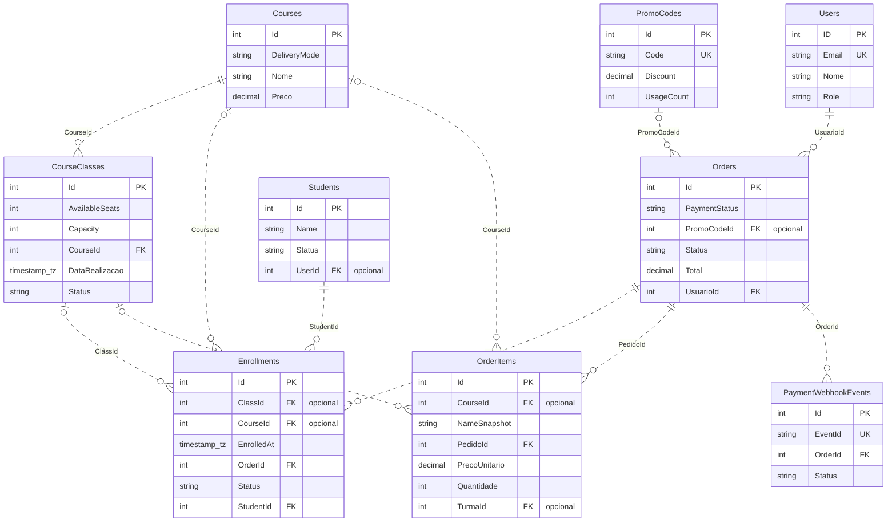
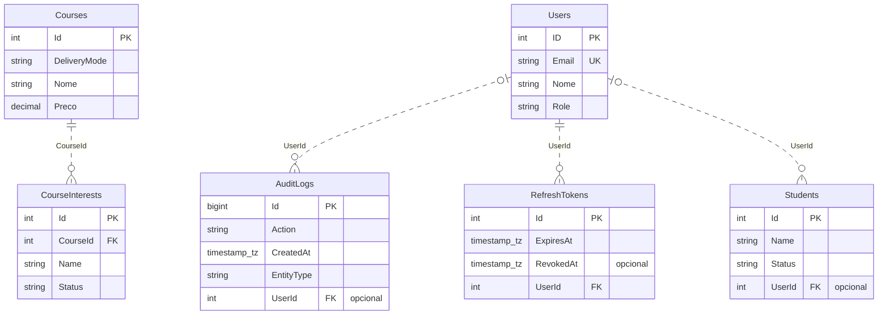
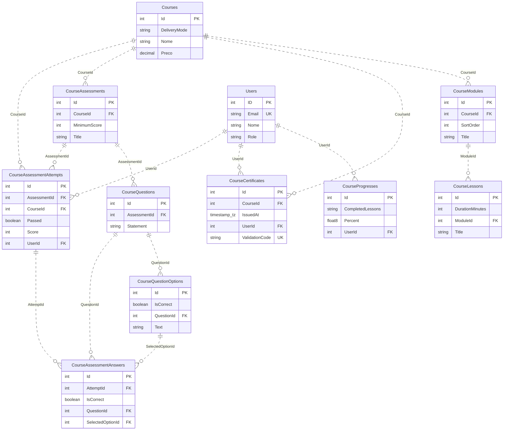

# Banco de dados, esquema relacional e DER — PIM4API

Referência: modelo EF Core/Npgsql do código local em 04/11/2026, extraído sem consultar um banco. O modelo foi confrontado com o snapshot das migrations, e não foram encontradas diferenças de schema. Essa conferência não comprova que o banco do Render tenha todas as migrations aplicadas.

O modelo contém **21 tabelas de aplicação, 166 colunas, 29 chaves estrangeiras e 35 índices além das chaves primárias**. A tabela técnica `__EFMigrationsHistory` acrescenta duas colunas, resultando em 22 tabelas e 168 colunas numa instalação com esse modelo e o histórico do EF. O esquema padrão é `public`.

## Arquivos de referência

- [Metadados completos do modelo](esquema-modelo.json): tabelas, tipos, nulabilidade, FKs, índices e migrations. Contém somente estrutura, sem registros.
- [DDL PostgreSQL de referência](esquema-referencia.sql): criação do modelo sem seeds. Usar migrations para criar/atualizar uma instalação; este arquivo não é um procedimento de atualização de produção.
- [DER completo em Mermaid](diagramas/der-completo.mmd): fonte editável do diagrama com todas as relações físicas.
- [Arquitetura da API](ARQUITETURA.md) e [arquitetura do sistema](../../PIM4Front/docs/ARQUITETURA.md).

## 1. Organização dos dados

| Domínio              | Tabelas                                                                                                                                                                                            |
| -------------------- | -------------------------------------------------------------------------------------------------------------------------------------------------------------------------------------------------- |
| Conta e auditoria    | `Users`, `RefreshTokens`, `AuditLogs`                                                                                                                                                              |
| Catálogo e contato   | `Courses`, `CourseClasses`, `CourseInterests`                                                                                                                                                      |
| Comercial e aluno    | `Students`, `Orders`, `OrderItems`, `Enrollments`, `PromoCodes`, `PaymentWebhookEvents`                                                                                                            |
| Conteúdo educacional | `CourseModules`, `CourseLessons`, `CourseAssessments`, `CourseQuestions`, `CourseQuestionOptions`, `CourseAssessmentAttempts`, `CourseAssessmentAnswers`, `CourseCertificates`, `CourseProgresses` |

O fluxo comercial habilitado é presencial. As estruturas educacionais/EAD existem no banco e no código; a criação de novas ofertas EAD está desabilitada. Não existe tabela `Products` no modelo atual.

## 2. Como ler o DER

Cada caixa apresenta campos principais; o dicionário abaixo contém todas as colunas. `PK` é chave primária, `FK` é chave estrangeira e `UK` indica uma unicidade de coluna individual. Unicidades compostas estão detalhadas nos índices.

Na ponta da tabela referenciada, `||` significa uma referência obrigatória e `|o` significa referência opcional. `o{` na tabela dependente significa zero ou muitos registros. As linhas pontilhadas indicam relações não identificadoras: as tabelas dependentes possuem sua própria PK. A nulabilidade é indicada também por “opcional” no campo.

A existência de uma relação obrigatória não obriga o registro principal a possuir dependentes. As cardinalidades descrevem as FKs, enquanto regras como uma vaga por aluno/curso são verificadas pelos serviços.

### Núcleo comercial e matrículas

### Identidade, alunos, auditoria e interesse

### Conteúdo, avaliações, progresso e certificados

## 3. Relações físicas e exclusão

| Dependente e FK                            | Referência                    | Obrigatória | Cardinalidade principal → dependente | Exclusão no banco / comportamento EF          |
| ------------------------------------------ | ----------------------------- | ----------- | ------------------------------------ | --------------------------------------------- |
| `AuditLogs.UserId`                         | `Users.ID`                    | Não         | 1 : 0..N                             | SET NULL                                      |
| `CourseAssessmentAnswers.AttemptId`        | `CourseAssessmentAttempts.Id` | Sim         | 1 : 0..N                             | CASCADE                                       |
| `CourseAssessmentAnswers.QuestionId`       | `CourseQuestions.Id`          | Sim         | 1 : 0..N                             | CASCADE                                       |
| `CourseAssessmentAnswers.SelectedOptionId` | `CourseQuestionOptions.Id`    | Sim         | 1 : 0..N                             | CASCADE                                       |
| `CourseAssessmentAttempts.AssessmentId`    | `CourseAssessments.Id`        | Sim         | 1 : 0..N                             | CASCADE                                       |
| `CourseAssessmentAttempts.CourseId`        | `Courses.Id`                  | Sim         | 1 : 0..N                             | CASCADE                                       |
| `CourseAssessmentAttempts.UserId`          | `Users.ID`                    | Sim         | 1 : 0..N                             | CASCADE                                       |
| `CourseAssessments.CourseId`               | `Courses.Id`                  | Sim         | 1 : 0..N                             | CASCADE                                       |
| `CourseCertificates.CourseId`              | `Courses.Id`                  | Sim         | 1 : 0..N                             | CASCADE                                       |
| `CourseCertificates.UserId`                | `Users.ID`                    | Sim         | 1 : 0..N                             | CASCADE                                       |
| `CourseClasses.CourseId`                   | `Courses.Id`                  | Sim         | 1 : 0..N                             | RESTRICT                                      |
| `CourseInterests.CourseId`                 | `Courses.Id`                  | Sim         | 1 : 0..N                             | CASCADE                                       |
| `CourseLessons.ModuleId`                   | `CourseModules.Id`            | Sim         | 1 : 0..N                             | CASCADE                                       |
| `CourseModules.CourseId`                   | `Courses.Id`                  | Sim         | 1 : 0..N                             | CASCADE                                       |
| `CourseProgresses.UserId`                  | `Users.ID`                    | Sim         | 1 : 0..N                             | CASCADE                                       |
| `CourseQuestionOptions.QuestionId`         | `CourseQuestions.Id`          | Sim         | 1 : 0..N                             | CASCADE                                       |
| `CourseQuestions.AssessmentId`             | `CourseAssessments.Id`        | Sim         | 1 : 0..N                             | CASCADE                                       |
| `Enrollments.ClassId`                      | `CourseClasses.Id`            | Não         | 1 : 0..N                             | SET NULL                                      |
| `Enrollments.CourseId`                     | `Courses.Id`                  | Não         | 1 : 0..N                             | SET NULL                                      |
| `Enrollments.OrderId`                      | `Orders.Id`                   | Sim         | 1 : 0..N                             | CASCADE                                       |
| `Enrollments.StudentId`                    | `Students.Id`                 | Sim         | 1 : 0..N                             | CASCADE                                       |
| `OrderItems.CourseId`                      | `Courses.Id`                  | Não         | 1 : 0..N                             | RESTRICT                                      |
| `OrderItems.PedidoId`                      | `Orders.Id`                   | Sim         | 1 : 0..N                             | CASCADE                                       |
| `OrderItems.TurmaId`                       | `CourseClasses.Id`            | Não         | 1 : 0..N                             | NO ACTION; EF pode limpar relações rastreadas |
| `Orders.PromoCodeId`                       | `PromoCodes.Id`               | Não         | 1 : 0..N                             | RESTRICT                                      |
| `Orders.UsuarioId`                         | `Users.ID`                    | Sim         | 1 : 0..N                             | CASCADE                                       |
| `PaymentWebhookEvents.OrderId`             | `Orders.Id`                   | Sim         | 1 : 0..N                             | CASCADE                                       |
| `RefreshTokens.UserId`                     | `Users.ID`                    | Sim         | 1 : 0..N                             | CASCADE                                       |
| `Students.UserId`                          | `Users.ID`                    | Não         | 1 : 0..N                             | SET NULL                                      |

A coluna “Obrigatória” informa se cada dependente exige a referência principal. `SET NULL` preserva o dependente limpando a FK; `RESTRICT`/`NO ACTION` impedem uma exclusão que viole a referência. `ClientSetNull` é comportamento do EF sobre entidades rastreadas e não equivale a `ON DELETE SET NULL` no PostgreSQL. Exclusões em cascata exigem atenção ao histórico; os fluxos usuais arquivam cursos e alteram estados em vez de apagar registros comerciais.

## 4. Índices e unicidade

As PKs das 21 tabelas são índices únicos próprios. Além delas, o modelo define os índices abaixo, incluindo os criados por convenção para FKs. Um índice de FK comum não torna a relação 1:1.

| Tabela                     | Índice                                                          | Colunas                               | Único | Filtro                       |
| -------------------------- | --------------------------------------------------------------- | ------------------------------------- | ----- | ---------------------------- |
| `AuditLogs`                | `IX_AuditLogs_UserId`                                           | `UserId`                              | Não   | —                            |
| `AuditLogs`                | `IX_AuditLogs_EntityType_EntityId_CreatedAt`                    | `EntityType, EntityId, CreatedAt`     | Não   | —                            |
| `CourseAssessmentAnswers`  | `IX_CourseAssessmentAnswers_AttemptId`                          | `AttemptId`                           | Não   | —                            |
| `CourseAssessmentAnswers`  | `IX_CourseAssessmentAnswers_QuestionId`                         | `QuestionId`                          | Não   | —                            |
| `CourseAssessmentAnswers`  | `IX_CourseAssessmentAnswers_SelectedOptionId`                   | `SelectedOptionId`                    | Não   | —                            |
| `CourseAssessmentAttempts` | `IX_CourseAssessmentAttempts_AssessmentId`                      | `AssessmentId`                        | Não   | —                            |
| `CourseAssessmentAttempts` | `IX_CourseAssessmentAttempts_CourseId`                          | `CourseId`                            | Não   | —                            |
| `CourseAssessmentAttempts` | `IX_CourseAssessmentAttempts_UserId_AssessmentId_AttemptNumber` | `UserId, AssessmentId, AttemptNumber` | Sim   | —                            |
| `CourseAssessments`        | `IX_CourseAssessments_CourseId`                                 | `CourseId`                            | Não   | —                            |
| `CourseCertificates`       | `IX_CourseCertificates_CourseId`                                | `CourseId`                            | Não   | —                            |
| `CourseCertificates`       | `IX_CourseCertificates_ValidationCode`                          | `ValidationCode`                      | Sim   | —                            |
| `CourseCertificates`       | `IX_CourseCertificates_UserId_CourseId`                         | `UserId, CourseId`                    | Sim   | —                            |
| `CourseClasses`            | `IX_CourseClasses_CourseId`                                     | `CourseId`                            | Não   | —                            |
| `CourseInterests`          | `IX_CourseInterests_CourseId_Email`                             | `CourseId, Email`                     | Sim   | —                            |
| `CourseLessons`            | `IX_CourseLessons_ModuleId`                                     | `ModuleId`                            | Não   | —                            |
| `CourseModules`            | `IX_CourseModules_CourseId`                                     | `CourseId`                            | Não   | —                            |
| `CourseProgresses`         | `IX_CourseProgresses_UserId_CourseId`                           | `UserId, CourseId`                    | Sim   | —                            |
| `CourseQuestionOptions`    | `IX_CourseQuestionOptions_QuestionId`                           | `QuestionId`                          | Não   | —                            |
| `CourseQuestions`          | `IX_CourseQuestions_AssessmentId`                               | `AssessmentId`                        | Não   | —                            |
| `Enrollments`              | `IX_Enrollments_ClassId`                                        | `ClassId`                             | Não   | —                            |
| `Enrollments`              | `IX_Enrollments_CourseId`                                       | `CourseId`                            | Não   | —                            |
| `Enrollments`              | `IX_Enrollments_OrderId`                                        | `OrderId`                             | Não   | —                            |
| `Enrollments`              | `IX_Enrollments_StudentId`                                      | `StudentId`                           | Não   | —                            |
| `OrderItems`               | `IX_OrderItems_CourseId`                                        | `CourseId`                            | Não   | —                            |
| `OrderItems`               | `IX_OrderItems_PedidoId`                                        | `PedidoId`                            | Não   | —                            |
| `OrderItems`               | `IX_OrderItems_TurmaId`                                         | `TurmaId`                             | Não   | —                            |
| `Orders`                   | `IX_Orders_PromoCodeId`                                         | `PromoCodeId`                         | Não   | —                            |
| `Orders`                   | `IX_Orders_UsuarioId_IdempotencyKey`                            | `UsuarioId, IdempotencyKey`           | Sim   | "IdempotencyKey" IS NOT NULL |
| `PaymentWebhookEvents`     | `IX_PaymentWebhookEvents_EventId`                               | `EventId`                             | Sim   | —                            |
| `PaymentWebhookEvents`     | `IX_PaymentWebhookEvents_OrderId`                               | `OrderId`                             | Não   | —                            |
| `PromoCodes`               | `IX_PromoCodes_Code`                                            | `Code`                                | Sim   | —                            |
| `RefreshTokens`            | `IX_RefreshTokens_Token`                                        | `Token`                               | Sim   | —                            |
| `RefreshTokens`            | `IX_RefreshTokens_UserId`                                       | `UserId`                              | Não   | —                            |
| `Students`                 | `IX_Students_UserId`                                            | `UserId`                              | Não   | —                            |
| `Users`                    | `IX_Users_Email`                                                | `Email`                               | Sim   | —                            |

Os índices únicos protegem e-mail de conta, código de cupom, evento de webhook, token de sessão, idempotência por usuário, sequência de tentativa, progresso por usuário/curso, certificado por usuário/curso, código de validação e contato interessado por curso/e-mail. Campos de situação são textos: listas permitidas e transições são controladas pelos serviços, não por enums PostgreSQL nesse modelo.

## 5. Dicionário de todas as colunas

Os tipos são os tipos físicos PostgreSQL obtidos do provedor Npgsql. “Aceita NULL” representa nulabilidade no banco. A coluna de padrão informa defaults configurados no modelo e geração de identidade; inicializadores em C# não significam, por si só, um `DEFAULT` no servidor.

### AuditLogs

Auditoria de ações, entidade afetada, valores anteriores/novos e ator opcional.

| Coluna          | Tipo PostgreSQL            | Aceita NULL | Chave/referência | Geração ou padrão no servidor |
| --------------- | -------------------------- | ----------- | ---------------- | ----------------------------- |
| `Id`            | `bigint`                   | Não         | PK               | Identidade por padrão         |
| `Action`        | `text`                     | Não         | —                | —                             |
| `CreatedAt`     | `timestamp with time zone` | Não         | —                | —                             |
| `EntityId`      | `text`                     | Não         | —                | —                             |
| `EntityType`    | `text`                     | Não         | —                | —                             |
| `NewValue`      | `text`                     | Sim         | —                | —                             |
| `PreviousValue` | `text`                     | Sim         | —                | —                             |
| `UserId`        | `integer`                  | Sim         | FK → `Users.ID`  | —                             |

### CourseAssessmentAnswers

Respostas da tentativa, questão e alternativa selecionada.

| Coluna             | Tipo PostgreSQL | Aceita NULL | Chave/referência                   | Geração ou padrão no servidor |
| ------------------ | --------------- | ----------- | ---------------------------------- | ----------------------------- |
| `Id`               | `integer`       | Não         | PK                                 | Identidade por padrão         |
| `AttemptId`        | `integer`       | Não         | FK → `CourseAssessmentAttempts.Id` | —                             |
| `IsCorrect`        | `boolean`       | Não         | —                                  | —                             |
| `QuestionId`       | `integer`       | Não         | FK → `CourseQuestions.Id`          | —                             |
| `SelectedOptionId` | `integer`       | Não         | FK → `CourseQuestionOptions.Id`    | —                             |

### CourseAssessmentAttempts

Tentativas de avaliação de um usuário, nota e resultado.

| Coluna          | Tipo PostgreSQL            | Aceita NULL | Chave/referência            | Geração ou padrão no servidor |
| --------------- | -------------------------- | ----------- | --------------------------- | ----------------------------- |
| `Id`            | `integer`                  | Não         | PK                          | Identidade por padrão         |
| `AssessmentId`  | `integer`                  | Não         | FK → `CourseAssessments.Id` | —                             |
| `AttemptNumber` | `integer`                  | Não         | —                           | —                             |
| `CourseId`      | `integer`                  | Não         | FK → `Courses.Id`           | —                             |
| `Passed`        | `boolean`                  | Não         | —                           | —                             |
| `Score`         | `integer`                  | Não         | —                           | —                             |
| `SubmittedAt`   | `timestamp with time zone` | Não         | —                           | —                             |
| `UserId`        | `integer`                  | Não         | FK → `Users.ID`             | —                             |

### CourseAssessments

Avaliações de um curso e seus limites de aprovação/tentativas.

| Coluna         | Tipo PostgreSQL | Aceita NULL | Chave/referência  | Geração ou padrão no servidor |
| -------------- | --------------- | ----------- | ----------------- | ----------------------------- |
| `Id`           | `integer`       | Não         | PK                | Identidade por padrão         |
| `CourseId`     | `integer`       | Não         | FK → `Courses.Id` | —                             |
| `IsActive`     | `boolean`       | Não         | —                 | —                             |
| `MaxAttempts`  | `integer`       | Não         | —                 | —                             |
| `MinimumScore` | `integer`       | Não         | —                 | —                             |
| `Title`        | `text`          | Não         | —                 | —                             |

### CourseCertificates

Certificado de usuário/curso e código de validação.

| Coluna           | Tipo PostgreSQL            | Aceita NULL | Chave/referência  | Geração ou padrão no servidor |
| ---------------- | -------------------------- | ----------- | ----------------- | ----------------------------- |
| `Id`             | `integer`                  | Não         | PK                | Identidade por padrão         |
| `CourseId`       | `integer`                  | Não         | FK → `Courses.Id` | —                             |
| `IssuedAt`       | `timestamp with time zone` | Não         | —                 | —                             |
| `UserId`         | `integer`                  | Não         | FK → `Users.ID`   | —                             |
| `ValidationCode` | `text`                     | Não         | —                 | —                             |

### CourseClasses

Turmas de um curso, datas, instrutor, local, capacidade, vagas e situação.

| Coluna           | Tipo PostgreSQL            | Aceita NULL | Chave/referência  | Geração ou padrão no servidor |
| ---------------- | -------------------------- | ----------- | ----------------- | ----------------------------- |
| `Id`             | `integer`                  | Não         | PK                | Identidade por padrão         |
| `AvailableSeats` | `integer`                  | Não         | —                 | `0`                           |
| `Capacity`       | `integer`                  | Não         | —                 | `0`                           |
| `CourseId`       | `integer`                  | Não         | FK → `Courses.Id` | —                             |
| `DataRealizacao` | `timestamp with time zone` | Não         | —                 | —                             |
| `EndDate`        | `timestamp with time zone` | Sim         | —                 | —                             |
| `Instructor`     | `text`                     | Não         | —                 | —                             |
| `Local`          | `text`                     | Não         | —                 | —                             |
| `Status`         | `text`                     | Não         | —                 | `"scheduled"`                 |

### CourseInterests

Registro de interesse por um curso, identificado por contato e situação.

| Coluna      | Tipo PostgreSQL            | Aceita NULL | Chave/referência  | Geração ou padrão no servidor |
| ----------- | -------------------------- | ----------- | ----------------- | ----------------------------- |
| `Id`        | `integer`                  | Não         | PK                | Identidade por padrão         |
| `CourseId`  | `integer`                  | Não         | FK → `Courses.Id` | —                             |
| `CreatedAt` | `timestamp with time zone` | Não         | —                 | —                             |
| `Email`     | `text`                     | Não         | —                 | —                             |
| `Name`      | `text`                     | Não         | —                 | —                             |
| `Phone`     | `text`                     | Sim         | —                 | —                             |
| `Status`    | `text`                     | Não         | —                 | —                             |

### CourseLessons

Aulas de um módulo, vídeo, duração e ordenação.

| Coluna            | Tipo PostgreSQL | Aceita NULL | Chave/referência        | Geração ou padrão no servidor |
| ----------------- | --------------- | ----------- | ----------------------- | ----------------------------- |
| `Id`              | `integer`       | Não         | PK                      | Identidade por padrão         |
| `Description`     | `text`          | Não         | —                       | —                             |
| `DurationMinutes` | `integer`       | Não         | —                       | —                             |
| `IsActive`        | `boolean`       | Não         | —                       | —                             |
| `ModuleId`        | `integer`       | Não         | FK → `CourseModules.Id` | —                             |
| `SortOrder`       | `integer`       | Não         | —                       | —                             |
| `Title`           | `text`          | Não         | —                       | —                             |
| `VideoUrl`        | `text`          | Não         | —                       | —                             |

### CourseModules

Módulos de conteúdo de um curso.

| Coluna      | Tipo PostgreSQL | Aceita NULL | Chave/referência  | Geração ou padrão no servidor |
| ----------- | --------------- | ----------- | ----------------- | ----------------------------- |
| `Id`        | `integer`       | Não         | PK                | Identidade por padrão         |
| `CourseId`  | `integer`       | Não         | FK → `Courses.Id` | —                             |
| `IsActive`  | `boolean`       | Não         | —                 | —                             |
| `SortOrder` | `integer`       | Não         | —                 | —                             |
| `Title`     | `text`          | Não         | —                 | —                             |

### CourseProgresses

Progresso de usuário/curso, percentual e lista serializada de aulas concluídas.

| Coluna             | Tipo PostgreSQL            | Aceita NULL | Chave/referência | Geração ou padrão no servidor |
| ------------------ | -------------------------- | ----------- | ---------------- | ----------------------------- |
| `Id`               | `integer`                  | Não         | PK               | Identidade por padrão         |
| `CompletedAt`      | `timestamp with time zone` | Sim         | —                | —                             |
| `CompletedLessons` | `text`                     | Não         | —                | —                             |
| `CourseId`         | `integer`                  | Não         | —                | —                             |
| `LastSeenAt`       | `timestamp with time zone` | Sim         | —                | —                             |
| `Percent`          | `double precision`         | Não         | —                | —                             |
| `UserId`           | `integer`                  | Não         | FK → `Users.ID`  | —                             |

### CourseQuestionOptions

Alternativas das questões e indicação de resposta correta.

| Coluna       | Tipo PostgreSQL | Aceita NULL | Chave/referência          | Geração ou padrão no servidor |
| ------------ | --------------- | ----------- | ------------------------- | ----------------------------- |
| `Id`         | `integer`       | Não         | PK                        | Identidade por padrão         |
| `IsCorrect`  | `boolean`       | Não         | —                         | —                             |
| `QuestionId` | `integer`       | Não         | FK → `CourseQuestions.Id` | —                             |
| `SortOrder`  | `integer`       | Não         | —                         | —                             |
| `Text`       | `text`          | Não         | —                         | —                             |

### CourseQuestions

Questões de uma avaliação.

| Coluna         | Tipo PostgreSQL | Aceita NULL | Chave/referência            | Geração ou padrão no servidor |
| -------------- | --------------- | ----------- | --------------------------- | ----------------------------- |
| `Id`           | `integer`       | Não         | PK                          | Identidade por padrão         |
| `AssessmentId` | `integer`       | Não         | FK → `CourseAssessments.Id` | —                             |
| `IsActive`     | `boolean`       | Não         | —                           | —                             |
| `SortOrder`    | `integer`       | Não         | —                           | —                             |
| `Statement`    | `text`          | Não         | —                           | —                             |

### Courses

Catálogo de cursos e metadados públicos utilizados também no recomendador.

| Coluna          | Tipo PostgreSQL | Aceita NULL | Chave/referência | Geração ou padrão no servidor |
| --------------- | --------------- | ----------- | ---------------- | ----------------------------- |
| `Id`            | `integer`       | Não         | PK               | Identidade por padrão         |
| `Category`      | `text`          | Não         | —                | —                             |
| `DeliveryMode`  | `text`          | Não         | —                | `"presencial"`                |
| `Description`   | `text`          | Não         | —                | —                             |
| `Image`         | `text`          | Não         | —                | —                             |
| `IsActive`      | `boolean`       | Não         | —                | —                             |
| `Nome`          | `text`          | Não         | —                | —                             |
| `Preco`         | `numeric`       | Não         | —                | —                             |
| `WorkloadHours` | `integer`       | Não         | —                | `0`                           |

### Enrollments

Matrículas do aluno originadas pelo pedido, com curso/turma opcionais e confirmação de participação.

| Coluna                     | Tipo PostgreSQL            | Aceita NULL | Chave/referência        | Geração ou padrão no servidor |
| -------------------------- | -------------------------- | ----------- | ----------------------- | ----------------------------- |
| `Id`                       | `integer`                  | Não         | PK                      | Identidade por padrão         |
| `ClassId`                  | `integer`                  | Sim         | FK → `CourseClasses.Id` | —                             |
| `CourseId`                 | `integer`                  | Sim         | FK → `Courses.Id`       | —                             |
| `EnrolledAt`               | `timestamp with time zone` | Não         | —                       | `CURRENT_TIMESTAMP`           |
| `OrderId`                  | `integer`                  | Não         | FK → `Orders.Id`        | —                             |
| `ParticipationConfirmedAt` | `timestamp with time zone` | Sim         | —                       | —                             |
| `ParticipationStartDate`   | `timestamp with time zone` | Sim         | —                       | —                             |
| `Status`                   | `text`                     | Não         | —                       | —                             |
| `StudentId`                | `integer`                  | Não         | FK → `Students.Id`      | —                             |

### OrderItems

Itens históricos do pedido, com snapshots de nome e preço e referências opcionais de curso/turma.

| Coluna          | Tipo PostgreSQL | Aceita NULL | Chave/referência        | Geração ou padrão no servidor |
| --------------- | --------------- | ----------- | ----------------------- | ----------------------------- |
| `Id`            | `integer`       | Não         | PK                      | Identidade por padrão         |
| `CourseId`      | `integer`       | Sim         | FK → `Courses.Id`       | —                             |
| `ItemType`      | `text`          | Não         | —                       | —                             |
| `NameSnapshot`  | `text`          | Não         | —                       | —                             |
| `PedidoId`      | `integer`       | Não         | FK → `Orders.Id`        | —                             |
| `PrecoUnitario` | `numeric`       | Não         | —                       | —                             |
| `Quantidade`    | `integer`       | Não         | —                       | —                             |
| `TurmaId`       | `integer`       | Sim         | FK → `CourseClasses.Id` | —                             |

### Orders

Pedido de uma conta, totais, situação comercial/financeira, cupom e chave de idempotência.

| Coluna             | Tipo PostgreSQL            | Aceita NULL | Chave/referência     | Geração ou padrão no servidor |
| ------------------ | -------------------------- | ----------- | -------------------- | ----------------------------- |
| `Id`               | `integer`                  | Não         | PK                   | Identidade por padrão         |
| `DataPedido`       | `timestamp with time zone` | Não         | —                    | —                             |
| `GatewayPaymentId` | `text`                     | Sim         | —                    | —                             |
| `IdempotencyKey`   | `text`                     | Sim         | —                    | —                             |
| `Installments`     | `integer`                  | Sim         | —                    | —                             |
| `PaidAt`           | `timestamp with time zone` | Sim         | —                    | —                             |
| `PaymentMethod`    | `text`                     | Não         | —                    | —                             |
| `PaymentStatus`    | `text`                     | Não         | —                    | `"pending"`                   |
| `PromoCode`        | `text`                     | Não         | —                    | —                             |
| `PromoCodeId`      | `integer`                  | Sim         | FK → `PromoCodes.Id` | —                             |
| `Status`           | `text`                     | Não         | —                    | `"pending"`                   |
| `Total`            | `numeric`                  | Não         | —                    | —                             |
| `UsuarioId`        | `integer`                  | Não         | FK → `Users.ID`      | —                             |
| `ValorFrete`       | `numeric`                  | Não         | —                    | —                             |

### PaymentWebhookEvents

Eventos financeiros recebidos/processados e vinculados a um pedido.

| Coluna        | Tipo PostgreSQL            | Aceita NULL | Chave/referência | Geração ou padrão no servidor |
| ------------- | -------------------------- | ----------- | ---------------- | ----------------------------- |
| `Id`          | `integer`                  | Não         | PK               | Identidade por padrão         |
| `EventId`     | `text`                     | Não         | —                | —                             |
| `OrderId`     | `integer`                  | Não         | FK → `Orders.Id` | —                             |
| `PaymentId`   | `text`                     | Não         | —                | —                             |
| `ProcessedAt` | `timestamp with time zone` | Sim         | —                | —                             |
| `ReceivedAt`  | `timestamp with time zone` | Não         | —                | —                             |
| `Status`      | `text`                     | Não         | —                | —                             |

### PromoCodes

Cupons, tipo/valor do desconto, período de validade e controle de uso.

| Coluna         | Tipo PostgreSQL | Aceita NULL | Chave/referência | Geração ou padrão no servidor |
| -------------- | --------------- | ----------- | ---------------- | ----------------------------- |
| `Id`           | `integer`       | Não         | PK               | Identidade por padrão         |
| `Code`         | `text`          | Não         | —                | —                             |
| `Discount`     | `numeric`       | Não         | —                | —                             |
| `DiscountType` | `text`          | Não         | —                | —                             |
| `EndDate`      | `text`          | Não         | —                | —                             |
| `IsActive`     | `boolean`       | Não         | —                | —                             |
| `StartDate`    | `text`          | Não         | —                | —                             |
| `UsageCount`   | `integer`       | Não         | —                | —                             |
| `UsageLimit`   | `integer`       | Sim         | —                | —                             |

### RefreshTokens

Sessões renováveis associadas à conta; o serviço persiste hash do token e sua rotação/revogação.

| Coluna            | Tipo PostgreSQL            | Aceita NULL | Chave/referência | Geração ou padrão no servidor |
| ----------------- | -------------------------- | ----------- | ---------------- | ----------------------------- |
| `Id`              | `integer`                  | Não         | PK               | Identidade por padrão         |
| `CreatedAt`       | `timestamp with time zone` | Não         | —                | —                             |
| `ExpiresAt`       | `timestamp with time zone` | Não         | —                | —                             |
| `ReplacedByToken` | `text`                     | Sim         | —                | —                             |
| `RevokedAt`       | `timestamp with time zone` | Sim         | —                | —                             |
| `Token`           | `text`                     | Não         | —                | —                             |
| `UserId`          | `integer`                  | Não         | FK → `Users.ID`  | —                             |

### Students

Cadastro administrativo de aluno, com vínculo opcional à conta e campos legados de apresentação.

| Coluna           | Tipo PostgreSQL | Aceita NULL | Chave/referência | Geração ou padrão no servidor |
| ---------------- | --------------- | ----------- | ---------------- | ----------------------------- |
| `Id`             | `integer`       | Não         | PK               | Identidade por padrão         |
| `CourseId`       | `text`          | Não         | —                | —                             |
| `CourseName`     | `text`          | Não         | —                | —                             |
| `Email`          | `text`          | Não         | —                | —                             |
| `EnrollmentDate` | `text`          | Não         | —                | —                             |
| `Name`           | `text`          | Não         | —                | —                             |
| `Phone`          | `text`          | Não         | —                | —                             |
| `Status`         | `text`          | Não         | —                | —                             |
| `UserId`         | `integer`       | Sim         | FK → `Users.ID`  | —                             |

### Users

Contas de autenticação, perfil, role e bloqueio por tentativas de login.

| Coluna                | Tipo PostgreSQL            | Aceita NULL | Chave/referência | Geração ou padrão no servidor |
| --------------------- | -------------------------- | ----------- | ---------------- | ----------------------------- |
| `ID`                  | `integer`                  | Não         | PK               | Identidade por padrão         |
| `City`                | `text`                     | Não         | —                | —                             |
| `Complement`          | `text`                     | Não         | —                | —                             |
| `Cpf`                 | `text`                     | Não         | —                | —                             |
| `Email`               | `text`                     | Não         | —                | —                             |
| `FailedLoginAttempts` | `integer`                  | Não         | —                | —                             |
| `LockoutEnd`          | `timestamp with time zone` | Sim         | —                | —                             |
| `Neighborhood`        | `text`                     | Não         | —                | —                             |
| `Nome`                | `text`                     | Não         | —                | —                             |
| `Number`              | `text`                     | Não         | —                | —                             |
| `Phone`               | `text`                     | Não         | —                | —                             |
| `Role`                | `text`                     | Não         | —                | —                             |
| `SenhaHash`           | `text`                     | Não         | —                | —                             |
| `State`               | `text`                     | Não         | —                | —                             |
| `Street`              | `text`                     | Não         | —                | —                             |
| `ZipCode`             | `text`                     | Não         | —                | —                             |

## 6. Particularidades e campos que não são relações físicas

- `Users` e `Students` são entidades distintas. `Students.UserId` é opcional e possui índice não único; a cardinalidade física é uma conta para zero ou muitos cadastros de aluno. Uma eventual regra 1:1 exigiria outra restrição.
- `Students.CourseId` é texto legado de apresentação, não FK de `Courses.Id`. As matrículas normalizadas estão em `Enrollments`.
- `CourseProgresses.CourseId` participa do índice único de usuário/curso e é usado pelos serviços, mas não possui FK física para `Courses` no modelo atual. O DER não inventa essa restrição.
- `CourseProgresses.CompletedLessons` é uma lista de IDs serializada em uma coluna `text`; não existe tabela de associação nem FKs individuais para cada aula da lista.
- `AuditLogs.EntityType`/`EntityId` identificam o alvo da auditoria por convenção da aplicação; não são FKs polimórficas para todas as tabelas. A FK física da auditoria é `UserId`.
- `OrderItems.NameSnapshot` e `PrecoUnitario` preservam o nome e preço históricos. `Orders.PromoCode` preserva texto; `PromoCodeId` é a relação física opcional com cupom.
- `CourseClasses.VafasDisponiveis` e `VagasDisponiveis` são aliases C# com `NotMapped`. A coluna persistida atual é `AvailableSeats`.
- `RefreshTokens.IsActive` é calculado e não é coluna. Os serviços armazenam hashes de tokens; o formato `text` do campo não representa token em claro no fluxo atual.
- `PromoCodes.StartDate`, `EndDate` e `Students.EnrollmentDate` são campos `text` neste schema. O dicionário preserva essa escolha atual, sem apresentá-los como tipos SQL `date`.
- Os valores monetários usam `numeric` sem precisão/escala explicitamente limitadas no mapeamento atual. As regras de apresentação monetária e cálculo ficam na aplicação.
- O schema não declara uma tabela `Roles`: `Users.Role` é uma coluna textual. Também não há tabelas para carrinho local, widget VLibras, cache de recomendações ou modelo ML.NET.

## 7. Regras comerciais e transações

Curso ativo, turma futura agendada, vaga disponível, limite de quantidade, vínculo do recurso com o usuário e transições financeiras são validados pelos serviços. O schema documentado não adiciona constraints `CHECK` que não existam no código.

Pedidos pendentes reservam vagas e expiram conforme configuração. A confirmação assinada valida o evento, atualiza o pedido e cria matrícula. Índices de idempotência/evento e transações coordenadas por advisory lock no PostgreSQL ajudam a evitar duplicações e disputas de vagas. Isso não significa que uma atualização SQL manual de `PaymentStatus` execute as mesmas regras.

Não existe unicidade física de matrícula por usuário/curso em `Enrollments`; a regra de compra atual é aplicada pelos serviços e sua coordenação transacional. As estruturas auxiliares de conteúdo têm unicidades próprias de progresso, tentativas e certificados.

## 8. Migrations e rastreabilidade

Foram encontradas 24 migrations. A mais recente é `20261024135217_HardenEnrollmentAndReservations`. O snapshot `AppDbContextModelSnapshot.cs` corresponde ao modelo desta extração.

`__EFMigrationsHistory` é mantida pelo EF Core e possui `MigrationId` (`character varying(150)`, PK) e `ProductVersion` (`character varying(32)`), ambas obrigatórias. Ela não é uma entidade de negócio e não está no DER da aplicação.

O DDL de referência não inclui o histórico técnico nem inserts de seeds. Não deve ser aplicado sobre uma instalação existente. A atualização do banco segue a sequência de migrations e o processo de backup/homologação descrito no README.

O arquivo JSON registra o commit-base e o hash das fontes de modelagem. Mudanças em Models, AppDbContext ou migrations exigem revisar os diagramas e atualizar os artefatos. A conexão de produção não foi consultada e nenhum DDL foi executado.
